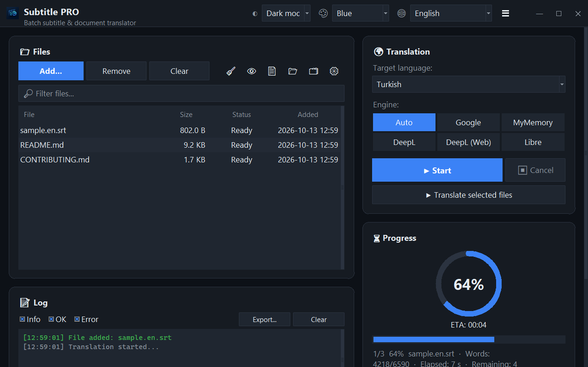

<div align="center">


# Subtitle PRO

**Batch-translate subtitles and documents — timestamps, numbering and line breaks stay exactly as they were.**

[](https://github.com/noms6/subtitle-pro/actions/workflows/tests.yml)    [](LICENSE)

🌐 **English** · [Türkçe](docs/readme/README.tr.md) · [Deutsch](docs/readme/README.de.md) · [Français](docs/readme/README.fr.md) · [Español](docs/readme/README.es.md) · [Italiano](docs/readme/README.it.md) · [Português](docs/readme/README.pt.md) · [Nederlands](docs/readme/README.nl.md) · [Polski](docs/readme/README.pl.md) · [Svenska](docs/readme/README.sv.md) · [Русский](docs/readme/README.ru.md) · [Українська](docs/readme/README.uk.md) · [العربية](docs/readme/README.ar.md) · [فارسی](docs/readme/README.fa.md) · [हिन्दी](docs/readme/README.hi.md) · [日本語](docs/readme/README.ja.md) · [한국어](docs/readme/README.ko.md) · [中文](docs/readme/README.zh.md) · [Bahasa Indonesia](docs/readme/README.id.md) · [Tiếng Việt](docs/readme/README.vi.md)



</div>

## ✨ Features

- Fast: a full-length film (≈1,500 lines) is translated in about 12 seconds — lines are sent in batches
- Subtitles: SRT and VTT — cue numbers, timestamps, `<i>` tags and line endings are preserved; UTF-8 output that Windows players read correctly
- Documents: TXT, Markdown, CSV, DOCX (body, tables, headers and footers) and PDF (saved as PDF or TXT)
- Engines: Google, MyMemory, DeepL API and LibreTranslate — if a service is rate-limited it automatically switches to another
- File queue with drag & drop, optional parallel processing, live progress and remaining time
- Skips files that are already in the target language; custom glossary (JSON/CSV) before or after translation
- Interface in 37 languages, light and dark themes with 6 accent colours; every setting is remembered
- Command line as well: `python translate_srt.py input.srt output.srt tr`

## 📥 Install (Windows)

1. Install [Python 3.10 or newer](https://www.python.org/downloads/) and tick “Add python.exe to PATH”.
2. Download the project ([ZIP](https://github.com/noms6/subtitle-pro/archive/refs/heads/main.zip)) or clone it, then install the dependencies:

   ```bash
   py -m pip install -r requirements.txt tkinterdnd2 langdetect
   ```

3. Double-click `run_app.bat` or `Subtitle PRO.pyw` — no console window stays open.

## 🧭 How to use

1. Add files with **Add...** or drag them into the window.
2. Pick the target language and an engine (**Auto** is recommended).
3. Press **▶ Start**. The result is saved next to the original, e.g. `movie.en.tr.srt`.
4. Check the result — names and interjections such as “Ah!” are intentionally left unchanged.

## 🖼️ Screenshots

<table>
<tr><td align="center"><br>Main window</td><td align="center"><br>Empty queue — drop your files here</td></tr>
<tr><td align="center"><br>Settings</td><td align="center"><br>Right-to-left languages</td></tr>
</table>

## 📊 Project status

Actively developed and covered by 270+ automated tests. Known issues and the roadmap are documented (in Turkish) in [KNOWN_ISSUES](docs/KNOWN_ISSUES.md) and [ROADMAP](docs/ROADMAP.md).

## 🛠️ Development

### Run from source

```bash
python -m venv .venv
.venv\Scripts\python -m pip install -r requirements.txt tkinterdnd2 langdetect
.venv\Scripts\python translate_srt.py                      # GUI
.venv\Scripts\python translate_srt.py in.srt out.tr.srt tr  # CLI
```

| Optional package | Used for |
|---|---|
| `tkinterdnd2` | drag & drop |
| `langdetect` | skipping files already in the target language, preview language hint |
| `python-docx`, `docx2txt` | DOCX |
| `pdfminer.six`, `reportlab` | reading / writing PDF |

API keys for DeepL / LibreTranslate go into environment variables (`DEEPL_API_KEY`, `LIBRE_URL`, `LIBRE_API_KEY`)
or `settings.json` (see `settings.example.json`).

### How translation works

```
file -> lines -> unique texts (deduplicated)
     -> Google JSON endpoint, many lines per request (bisected if Google merges lines)
     -> failures: Google per line -> MyMemory -> recovery rounds
     -> each endpoint gets a 10-minute circuit breaker after HTTP 429
     -> translations put back in place; numbers, timestamps, whitespace and CRLF untouched
```

### Project layout

```
translate_srt.py        app: GUI (Tkinter, own design system) + CLI + translation engine
ui_translations.json    UI strings, 37 languages
lang_names.json         target-language names in every UI language
run_app.bat             launcher without a console window (also: "Subtitle PRO.pyw")
tests/                  pytest suite (offline; fake engines, real GUI, real DOCX/PDF)
tools/
  ui_audit.py           opens the real GUI in every language, reports untranslated / clipped widgets
  i18n_sync.py          syncs ui_translations.json with the source, fills missing strings
  i18n_overrides.json   hand-checked terms where machine translation picks the wrong sense
  make_readmes.py       generates these READMEs (20 languages)
  readme_shots.py       README screenshots
  benchmark.py          offline request-count benchmark
docs/                   KNOWN_ISSUES, TESTING, ROADMAP (Turkish), screenshots
```

### Tests

```bash
.venv\Scripts\python -m pip install -r requirements-dev.txt
.venv\Scripts\python -m pytest            # offline, ~35 s
.venv\Scripts\python -m pytest -m network # optional live checks
```

Known bugs are recorded as `xfail(strict=True)`: once a bug is fixed the test reports XPASS and CI goes red until
the marker is removed — the test suite doubles as the bug list. See [docs/TESTING.md](docs/TESTING.md).

### Translations

Add UI text with `self._tr("English text")`, then run `python tools/i18n_sync.py --fill` and
`python tools/ui_audit.py`. Wrong term in your language? Add it to `tools/make_i18n_overrides.py`.
README texts live in `tools/make_readmes.py`.


## 📜 License

[MIT](LICENSE) © noms6
