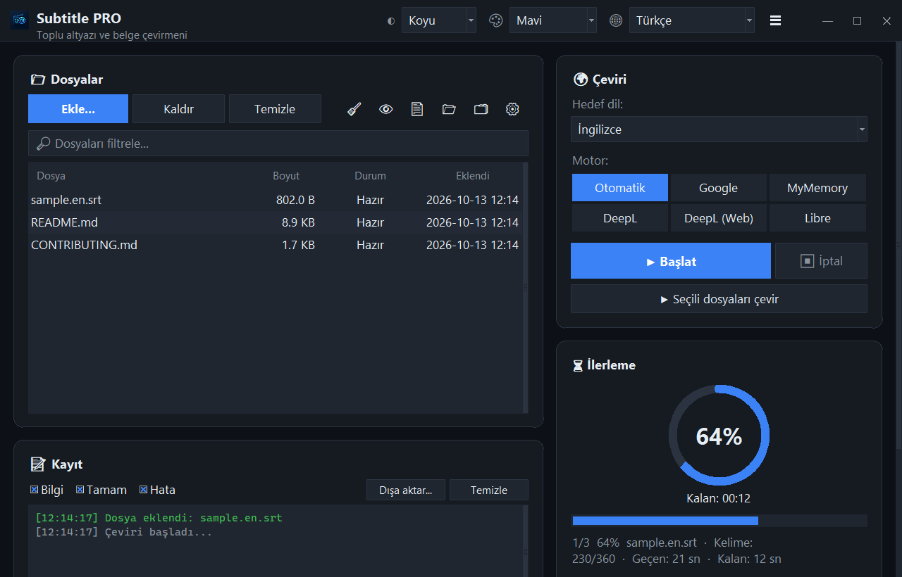
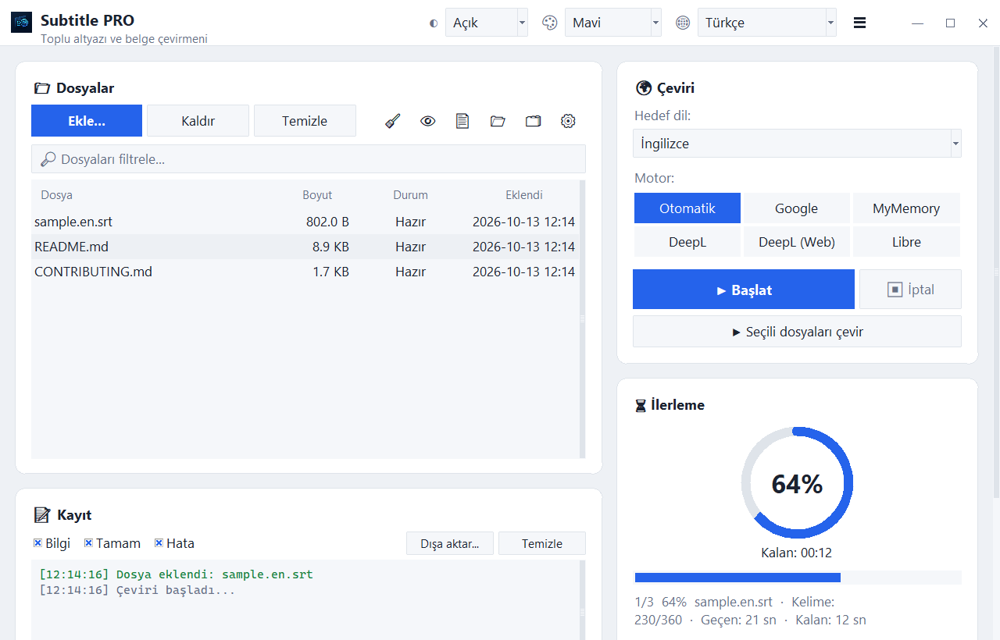
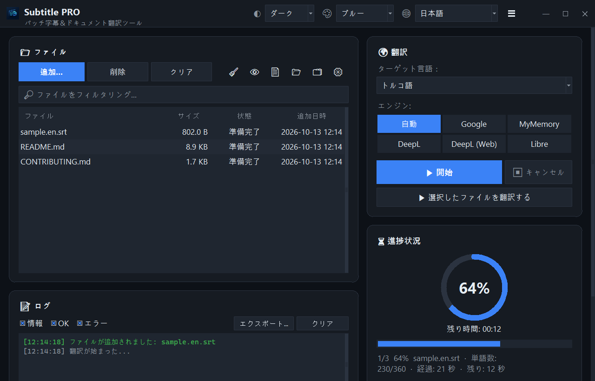
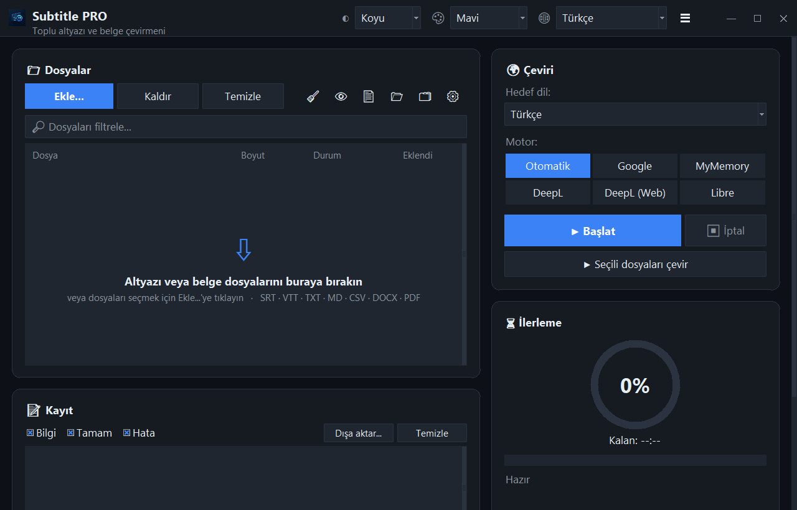
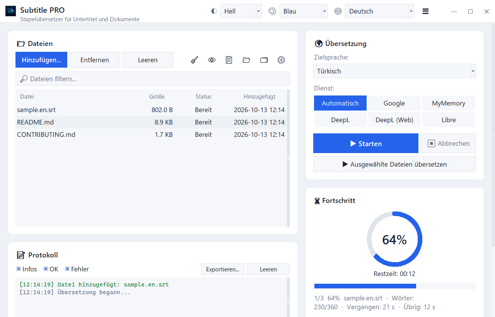
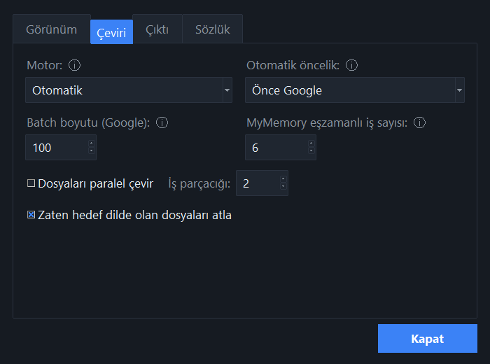
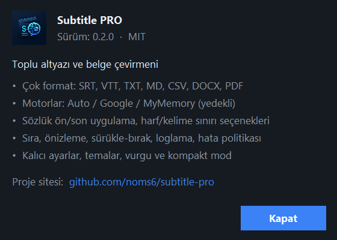

<div align="center">


# Subtitle PRO — Multi Translator

**SRT / VTT altyazılarını ve TXT · MD · CSV · DOCX · PDF belgelerini toplu çeviren masaüstü uygulaması**

Zaman damgaları, sıra numaraları ve satır yapısı korunur · Çoklu motor · Sürükle-bırak · 37 arayüz dili

[](https://github.com/noms6/subtitle-pro/actions/workflows/tests.yml)


[](LICENSE)

[Özellikler](#özellikler) · [Kurulum](#kurulum) · [Kullanım](#kullanım) · [Bilinen sorunlar](docs/KNOWN_ISSUES.md) · [Yol haritası](docs/ROADMAP.md) · [English](#english)



</div>

---

> [!WARNING]
> **Alpha sürüm.** Uzun dosyalarda Google hız sınırına (HTTP 429) takılınca bazı satırlar **çevrilmeden** kalabiliyor ve uygulama bunu şu an bildirmiyor. Çıktıyı mutlaka kontrol edin. Ayrıntılar ve geçici çözümler için: [Bilinen sorunlar → H1](docs/KNOWN_ISSUES.md#h1--rate-limit-429-durumunda-çeviri-sessizce-kayboluyor). Düzeltme planı: [Yol haritası → Faz 1–2](docs/ROADMAP.md).

## Özellikler

| | |
|---|---|
| 🎬 **Altyazı** | `.srt`, `.vtt` — sıra no, zaman damgası, boşluklar, CRLF korunur; çıktı Windows oynatıcılarıyla uyumlu UTF-8 BOM |
| 📄 **Belgeler** | `.txt`, `.md`, `.csv`, `.docx` (gövde, tablo, üst/alt bilgi), `.pdf` (metin çıkarıp PDF veya TXT yazar, Türkçe glif desteği) |
| 🔁 **Motorlar** | Google, MyMemory, DeepL API, LibreTranslate; *Auto* modda öncelik seçimi ve yedek motor |
| ⚡ **Toplu iş** | Çoklu dosya kuyruğu, isteğe bağlı paralel dosya işleme, satır tekilleştirme, ilerleme ve kalan süre |
| 🧠 **Akıllı** | Kaynak dil zaten hedef dilse dosyayı atlar (langdetect); özel terim sözlüğü (JSON/CSV, çeviri öncesi/sonrası) |
| 🖥️ **Arayüz** | Kendi tasarım sistemi (ek tema kütüphanesi gerekmez): tek başlık çubuğu, iki sütunlu düzen, açık/koyu tema × 6 vurgu rengi, motor seçim çipleri, sürükle-bırak alanı, tek pencerede toplanmış Ayarlar, renkli log |
| 🌍 **37 arayüz dili** | Anında dil değişimi; dil listesi yerel adlarla (Deutsch, 日本語, العربية); 133 hedef dilin adı her arayüz dilinde yerelleştirilmiş |
| ⌨️ **CLI** | `translate_srt.py girdi.srt cikti.srt tr` |

## Ekran görüntüleri

| Açık · Türkçe | Koyu · 日本語 |
|---|---|
|  |  |
| **Boş kuyruk (sürükle-bırak alanı)** | **Açık · Deutsch** |
|  |  |
| **Ayarlar** | **Hakkında** |
|  |  |

## Kurulum

**Gereksinim:** Python 3.8+ (3.10 ile test edildi), Windows önerilir.

```bash
git clone https://github.com/noms6/subtitle-pro.git
cd subtitle-pro
py -m venv .venv
.venv\Scripts\python -m pip install -r requirements.txt tkinterdnd2 langdetect
```

<details>
<summary>Linux / macOS</summary>

```bash
python3 -m venv .venv
source .venv/bin/activate
pip install -r requirements.txt tkinterdnd2 langdetect
# Debian/Ubuntu: sudo apt install python3-tk
```
</details>

| Paket | Ne için | Zorunlu mu |
|---|---|---|
| `deep-translator` | Çeviri motorları | ✅ |
| `tkinterdnd2` | Sürükle-bırak | isteğe bağlı |
| `langdetect` | Aynı dildeki dosyayı atlama | isteğe bağlı |
| `python-docx`, `docx2txt` | DOCX | DOCX için |
| `pdfminer.six`, `reportlab` | PDF okuma/yazma | PDF için |

## Kullanım

### Arayüz
```bash
.venv\Scripts\python translate_srt.py
```
Windows'ta `run_app.bat` dosyasına çift tıklamak da yeterli.

1. **Ekle…** ile dosyaları seçin veya pencereye sürükleyin.
2. Sağdaki **Çeviri** panelinden hedef dili seçin (son seçim hatırlanır; ilk açılışta arayüz dili ya da Türkçe).
3. **Motor** seçin (*Oto* önerilir) ve **Başlat**.
4. Çıktı aynı klasöre `film.tr.srt` gibi kaydedilir; isterseniz ayrı bir çıktı klasörü seçebilirsiniz.

### Komut satırı
```bash
python translate_srt.py girdi.srt cikti.tr.srt tr
```
Üçüncü argüman hedef dil kodudur (`tr`, `en`, `de`, `fr`, `es`, …; varsayılan `tr`).

### Motorlar ve API anahtarları

| Motor | Anahtar | Not |
|---|---|---|
| Google | gerekmez | Resmi olmayan uç nokta; yoğun kullanımda IP geçici olarak engellenebilir |
| MyMemory | gerekmez | Anonim günlük kotası düşüktür |
| DeepL | `DEEPL_API_KEY` | DeepL API Free/Pro anahtarı |
| LibreTranslate | `LIBRE_URL`, `LIBRE_API_KEY` | Kendi sunucunuz veya libretranslate.com |

Anahtarlar ortam değişkeni ya da `settings.json` ile verilebilir (örnek: [`settings.example.json`](settings.example.json)).
`settings.json` kişisel olduğundan depoya eklenmez.

## Proje yapısı

```
translate_srt.py        Uygulama (GUI + CLI + çeviri motoru) — tek dosya, modüllere bölünmesi planlı
ui_translations.json    Arayüz dil paketleri (37 dil × 153 metin)
lang_names.json         Hedef dil adları, her arayüz dilinde (37 × 133)
requirements*.txt       Bağımlılıklar
tests/                  306 çevrimdışı + 4 canlı test (pytest)
tools/benchmark.py      Çevrimdışı performans ölçümü
tools/ui_audit.py       Tüm dillerde arayüzü gezip çevrilmemiş/kırpılan metinleri raporlar
tools/i18n_sync.py      Dil paketlerini kaynakla eşitler (eksikleri doldurur, çöp anahtarları temizler)
tools/screenshots.py    README ekran görüntülerini üretir
docs/                   Bilinen sorunlar, test raporu, yol haritası, ekran görüntüleri
```

## Testler

```bash
.venv\Scripts\python -m pip install -r requirements-dev.txt
.venv\Scripts\python -m pytest
```

Paket ağa çıkmaz (sahte motorlar), gerçek GUI'yi ve gerçek DOCX/PDF dosyalarını test eder.
Bilinen her hata `xfail(strict=True)` ile kayıtlıdır; düzeltildiğinde CI uyarır.
Son sonuç: **264 geçti · 42 belgelenmiş hata (xfail)** — ayrıntı: [docs/TESTING.md](docs/TESTING.md).

## Durum

Kapsamlı bir denetim yapıldı: **77 sorun** önem sırasına göre kataloglandı; arayüz, pencereler ve dil tarafındaki **38'i düzeltildi**.

**Düzeltildi (arayüz turu):** dil paketlerinin %80'e varan çevrilmemiş kısmı, Japonca paketteki Korece metinler, worker thread'in
Tkinter'a doğrudan erişmesi, çalışmayan fare tekerleği ve log filtreleri, görünmeyen menüler, 133 yerine 37 hedef dil,
silinen API anahtarları, açılışta kaybolan koyu tema, yanlış varsayılan hedef dil ("Almanca").

**Açık (çeviri motoru):**
- 🔴 Hız sınırında sessiz çeviri kaybı ve "toplu" çevirinin aslında satır başına istek olması — bir film 1.401 istek yerine **8 istekle** çevrilebilir (ölçüldü: 80 satır 55.6 sn → 1.0 sn)
- 🔴 Paylaşılan translator nesnesinde yarış durumu, HTTP zaman aşımı yok

Tam liste: [docs/KNOWN_ISSUES.md](docs/KNOWN_ISSUES.md) · Plan: [docs/ROADMAP.md](docs/ROADMAP.md)

## Yol haritası (özet)

- **Faz 1** — Doğruluk ve güvenlik: hiçbir satır sessizce kaybolmasın, thread güvenliği, ayarlar
- **Faz 2** — Gerçek toplu istek, hız sınırlayıcı, kalıcı önbellek (tam film < 60 sn)
- **Faz 3** — Replik bazlı çeviri, etiket koruma, akıllı satır dengeleme
- **Faz 4** — Modüler mimari
- **Faz 5** — LLM motoru, yan yana düzenleyici, ASS + MKV desteği, dizi modu, çevrimdışı motor
- **Faz 6** — Tek `.exe` ve otomatik sürümler

## Katkı

Hata bildirimi ve önerilere açığız — [CONTRIBUTING.md](CONTRIBUTING.md).
Bir hatayı düzelttiyseniz ilgili `xfail` işaretini kaldırmayı unutmayın.

**Çeviri katkısı:** arayüz çevirilerinin çoğu makine çevirisidir; kısa ve belirsiz terimler ("Temizle", "Gözat", "Tema"…)
36 dil için elle kontrol edildi ([`tools/i18n_overrides.json`](tools/i18n_overrides.json)). Ana diliniz için düzeltmeleri
o dosyaya ekleyip `python tools/i18n_sync.py --write` çalıştırmanız yeterli.

## Lisans

[MIT](LICENSE) © 2026 noms6

---

## English

**Subtitle PRO** is a Tkinter desktop app and CLI that batch-translates `.srt` / `.vtt` subtitles and `.txt`, `.md`, `.csv`, `.docx`, `.pdf` documents while preserving cue numbers, timestamps and layout. It supports Google, MyMemory, DeepL API and LibreTranslate, with drag-and-drop, a file queue, dark mode and 20+ UI languages.

> **Alpha:** when Google rate-limits (HTTP 429), some lines can silently stay untranslated. See [known issues](docs/KNOWN_ISSUES.md) (Turkish) and the [roadmap](docs/ROADMAP.md).

```bash
pip install -r requirements.txt
python translate_srt.py                         # GUI
python translate_srt.py in.srt out.tr.srt tr    # CLI
python -m pytest                                # offline test suite
```
