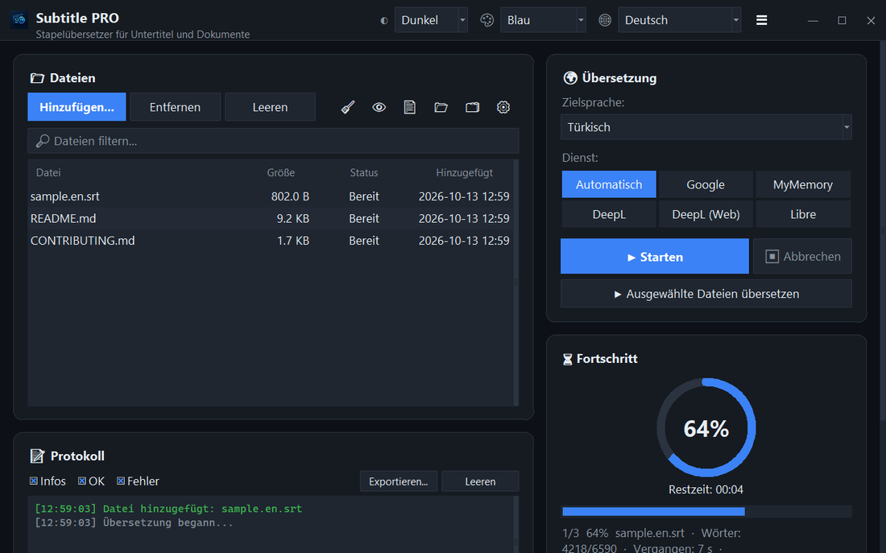

<div align="center">


# Subtitle PRO

**Untertitel und Dokumente stapelweise übersetzen — Zeitstempel, Nummerierung und Zeilenumbrüche bleiben exakt erhalten.**

[](https://github.com/noms6/subtitle-pro/actions/workflows/tests.yml)    [](../../LICENSE)

🌐 [English](../../README.md) · [Türkçe](README.tr.md) · **Deutsch** · [Français](README.fr.md) · [Español](README.es.md) · [Italiano](README.it.md) · [Português](README.pt.md) · [Nederlands](README.nl.md) · [Polski](README.pl.md) · [Svenska](README.sv.md) · [Русский](README.ru.md) · [Українська](README.uk.md) · [العربية](README.ar.md) · [فارسی](README.fa.md) · [हिन्दी](README.hi.md) · [日本語](README.ja.md) · [한국어](README.ko.md) · [中文](README.zh.md) · [Bahasa Indonesia](README.id.md) · [Tiếng Việt](README.vi.md)



</div>

## ✨ Funktionen

- Schnell: Ein ganzer Spielfilm (≈1.500 Zeilen) ist in etwa 12 Sekunden übersetzt — Zeilen werden gebündelt gesendet
- Untertitel: SRT und VTT — Nummern, Zeitstempel, `<i>` Tags und Zeilenenden bleiben erhalten; UTF-8-Ausgabe, die Windows-Player korrekt lesen
- Dokumente: TXT, Markdown, CSV, DOCX (Text, Tabellen, Kopf- und Fußzeilen) und PDF (als PDF oder TXT gespeichert)
- Dienste: Google, MyMemory, DeepL API und LibreTranslate — wird ein Dienst gedrosselt, wird automatisch gewechselt
- Dateiwarteschlange mit Drag & Drop, optional parallele Verarbeitung, Live-Fortschritt und Restzeit
- Überspringt Dateien, die bereits in der Zielsprache sind; eigenes Glossar (JSON/CSV) vor oder nach der Übersetzung
- Oberfläche in 37 Sprachen, helles und dunkles Design mit 6 Akzentfarben; alle Einstellungen werden gespeichert
- Auch per Kommandozeile: `python translate_srt.py eingabe.srt ausgabe.srt de`

## 📥 Installation (Windows)

1. [Python 3.10 oder neuer](https://www.python.org/downloads/) installieren und „Add python.exe to PATH“ ankreuzen.
2. Projekt herunterladen ([ZIP](https://github.com/noms6/subtitle-pro/archive/refs/heads/main.zip)) oder klonen und die Abhängigkeiten installieren:

   ```bash
   py -m pip install -r requirements.txt tkinterdnd2 langdetect
   ```

3. `run_app.bat` oder `Subtitle PRO.pyw` doppelklicken — es bleibt kein Konsolenfenster offen.

## 🧭 Verwendung

1. Dateien mit **Hinzufügen...** wählen oder ins Fenster ziehen.
2. Zielsprache und Dienst wählen (**Automatisch** wird empfohlen).
3. **▶ Starten** drücken. Das Ergebnis wird neben dem Original gespeichert, z. B. `film.en.de.srt`.
4. Ergebnis prüfen — Namen und Ausrufe wie „Ah!“ bleiben absichtlich unverändert.

## 🖼️ Screenshots

<table>
<tr><td align="center"><br>Hauptfenster</td><td align="center"><br>Leere Warteschlange — Dateien hier ablegen</td></tr>
<tr><td align="center"><br>Einstellungen</td><td align="center"><br>Sprachen von rechts nach links</td></tr>
</table>

## 📊 Projektstatus

Wird aktiv entwickelt und durch über 270 automatisierte Tests abgesichert. Bekannte Probleme und Roadmap (auf Türkisch): [KNOWN_ISSUES](../../docs/KNOWN_ISSUES.md) und [ROADMAP](../../docs/ROADMAP.md).

## 🛠️ Entwicklung

Architektur, Tests und Übersetzungsleitfaden: siehe [Haupt-README](../../README.md#development).

## 📜 Lizenz

[MIT](../../LICENSE) © noms6
