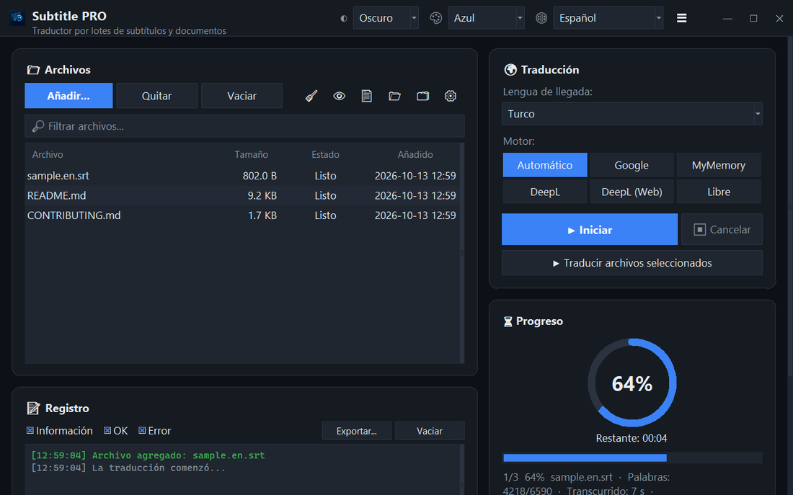

<div align="center">


# Subtitle PRO

**Traduce subtítulos y documentos por lotes — las marcas de tiempo, la numeración y los saltos de línea quedan intactos.**

[](https://github.com/noms6/subtitle-pro/actions/workflows/tests.yml)    [](../../LICENSE)

🌐 [English](../../README.md) · [Türkçe](README.tr.md) · [Deutsch](README.de.md) · [Français](README.fr.md) · **Español** · [Italiano](README.it.md) · [Português](README.pt.md) · [Nederlands](README.nl.md) · [Polski](README.pl.md) · [Svenska](README.sv.md) · [Русский](README.ru.md) · [Українська](README.uk.md) · [العربية](README.ar.md) · [فارسی](README.fa.md) · [हिन्दी](README.hi.md) · [日本語](README.ja.md) · [한국어](README.ko.md) · [中文](README.zh.md) · [Bahasa Indonesia](README.id.md) · [Tiếng Việt](README.vi.md)



</div>

## ✨ Características

- Rápido: una película completa (≈1.500 líneas) se traduce en unos 12 segundos — las líneas se envían por lotes
- Subtítulos: SRT y VTT — se conservan números, marcas de tiempo, `<i>` etiquetas y finales de línea; salida UTF-8 que los reproductores de Windows leen bien
- Documentos: TXT, Markdown, CSV, DOCX (cuerpo, tablas, encabezados y pies) y PDF (guardado como PDF o TXT)
- Motores: Google, MyMemory, DeepL API y LibreTranslate — si un servicio se limita, cambia automáticamente a otro
- Cola de archivos con arrastrar y soltar, procesamiento en paralelo opcional, progreso y tiempo restante en vivo
- Omite los archivos que ya están en el idioma de destino; glosario propio (JSON/CSV) antes o después de traducir
- Interfaz en 37 idiomas, temas claro y oscuro con 6 colores de acento; se recuerdan todos los ajustes
- También por línea de comandos: `python translate_srt.py entrada.srt salida.srt es`

## 📥 Instalación (Windows)

1. Instala [Python 3.10 o posterior](https://www.python.org/downloads/) y marca “Add python.exe to PATH”.
2. Descarga el proyecto ([ZIP](https://github.com/noms6/subtitle-pro/archive/refs/heads/main.zip)) o clónalo y luego instala las dependencias:

   ```bash
   py -m pip install -r requirements.txt tkinterdnd2 langdetect
   ```

3. Haz doble clic en `run_app.bat` o `Subtitle PRO.pyw` — no queda ninguna ventana de consola abierta.

## 🧭 Uso

1. Añade archivos con **Añadir...** o arrástralos a la ventana.
2. Elige el idioma de destino y un motor (se recomienda **Automático**).
3. Pulsa **▶ Iniciar**. El resultado se guarda junto al original, p. ej. `pelicula.en.es.srt`.
4. Revisa el resultado — los nombres e interjecciones como “¡Ah!” se dejan sin cambios a propósito.

## 🖼️ Capturas de pantalla

<table>
<tr><td align="center"><br>Ventana principal</td><td align="center"><br>Cola vacía — suelta tus archivos aquí</td></tr>
<tr><td align="center"><br>Ajustes</td><td align="center"><br>Idiomas de derecha a izquierda</td></tr>
</table>

## 📊 Estado del proyecto

En desarrollo activo y cubierto por más de 270 pruebas automáticas. Problemas conocidos y hoja de ruta (en turco): [KNOWN_ISSUES](../../docs/KNOWN_ISSUES.md) y [ROADMAP](../../docs/ROADMAP.md).

## 🛠️ Desarrollo

Arquitectura, pruebas y guía de traducción: consulta el [README principal](../../README.md#development).

## 📜 Licencia

[MIT](../../LICENSE) © noms6
