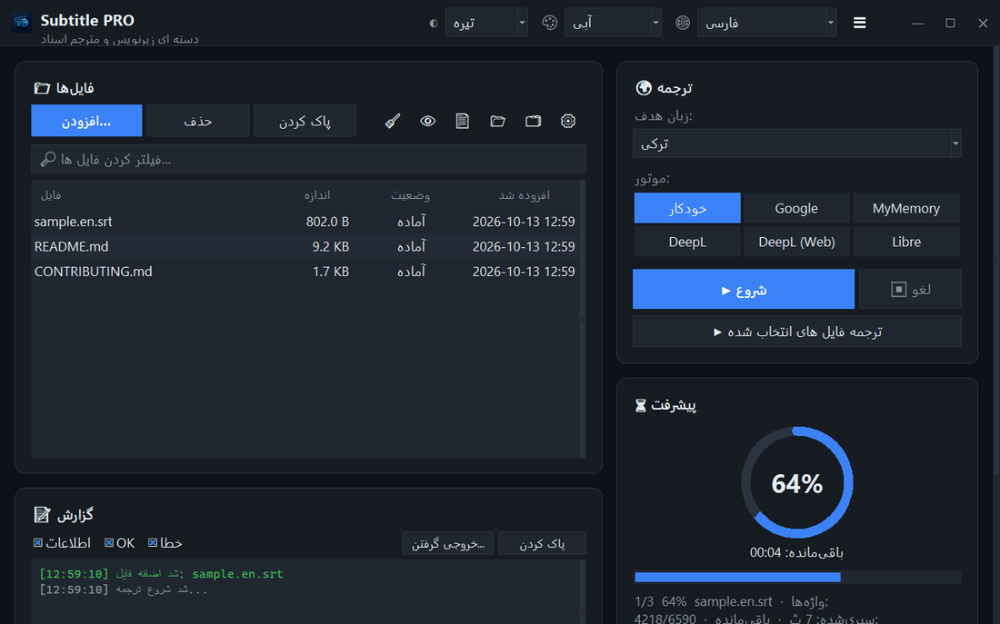

<div align="center">


# Subtitle PRO

**ترجمهٔ گروهی زیرنویس‌ها و اسناد — زمان‌بندی، شماره‌گذاری و شکست خطوط دقیقاً همان‌طور که بودند باقی می‌مانند.**

[](https://github.com/noms6/subtitle-pro/actions/workflows/tests.yml)    [](../../LICENSE)

🌐 [English](../../README.md) · [Türkçe](README.tr.md) · [Deutsch](README.de.md) · [Français](README.fr.md) · [Español](README.es.md) · [Italiano](README.it.md) · [Português](README.pt.md) · [Nederlands](README.nl.md) · [Polski](README.pl.md) · [Svenska](README.sv.md) · [Русский](README.ru.md) · [Українська](README.uk.md) · [العربية](README.ar.md) · **فارسی** · [हिन्दी](README.hi.md) · [日本語](README.ja.md) · [한국어](README.ko.md) · [中文](README.zh.md) · [Bahasa Indonesia](README.id.md) · [Tiếng Việt](README.vi.md)



</div>

<div dir="rtl">

## ✨ ویژگی‌ها

- سریع: یک فیلم کامل (≈۱۵۰۰ خط) در حدود ۱۲ ثانیه ترجمه می‌شود — خطوط به‌صورت دسته‌ای ارسال می‌شوند
- زیرنویس‌ها: SRT و VTT — شماره‌ها، زمان‌بندی‌ها، `<i>` برچسب‌ها و پایان خطوط حفظ می‌شوند؛ خروجی UTF-8 که پخش‌کننده‌های Windows درست می‌خوانند
- اسناد: TXT، Markdown، CSV، DOCX (متن، جدول‌ها، سرصفحه و پاصفحه) و PDF (ذخیره به‌صورت PDF یا TXT)
- سرویس‌ها: Google، MyMemory، DeepL API و LibreTranslate — اگر سرویسی محدود شود، برنامه خودکار به سرویس دیگری می‌رود
- صف فایل با کشیدن و رها کردن، پردازش موازی اختیاری، پیشرفت و زمان باقی‌مانده به‌صورت زنده
- فایل‌هایی را که از قبل به زبان مقصد هستند رد می‌کند؛ واژه‌نامهٔ سفارشی (JSON/CSV) پیش یا پس از ترجمه
- رابط کاربری به ۳۷ زبان، پوستهٔ روشن و تیره با ۶ رنگ تأکیدی؛ همهٔ تنظیمات به خاطر سپرده می‌شوند
- از خط فرمان هم: `python translate_srt.py input.srt output.srt fa`

## 📥 نصب (Windows)

1. [Python 3.10 یا جدیدتر](https://www.python.org/downloads/) را نصب کنید و گزینهٔ «Add python.exe to PATH» را علامت بزنید.
2. پروژه را دانلود کنید ([ZIP](https://github.com/noms6/subtitle-pro/archive/refs/heads/main.zip)) یا کلون کنید، سپس وابستگی‌ها را نصب کنید:

   ```bash
   py -m pip install -r requirements.txt tkinterdnd2 langdetect
   ```

3. روی `run_app.bat` یا `Subtitle PRO.pyw` دوبار کلیک کنید — هیچ پنجرهٔ کنسولی باز نمی‌ماند.

## 🧭 نحوهٔ استفاده

1. فایل‌ها را با **افزودن...** اضافه کنید یا به داخل پنجره بکشید.
2. زبان مقصد و سرویس را انتخاب کنید (**خودکار** پیشنهاد می‌شود).
3. **▶ شروع** را بزنید. نتیجه کنار فایل اصلی ذخیره می‌شود، مثلاً `film.en.fa.srt`.
4. نتیجه را بررسی کنید — نام‌ها و صوت‌هایی مانند «آه!» عمداً تغییر نمی‌کنند.

## 🖼️ تصاویر صفحه

<table>
<tr><td align="center"><br>پنجرهٔ اصلی</td><td align="center"><br>صف خالی — فایل‌ها را اینجا رها کنید</td></tr>
<tr><td align="center"><br>تنظیمات</td><td align="center"><br>زبان‌های راست‌به‌چپ</td></tr>
</table>

## 📊 وضعیت پروژه

در حال توسعهٔ فعال و تحت پوشش بیش از ۲۷۰ آزمون خودکار. مشکلات شناخته‌شده و نقشهٔ راه (به ترکی): [KNOWN_ISSUES](../../docs/KNOWN_ISSUES.md) و [ROADMAP](../../docs/ROADMAP.md).

## 🛠️ توسعه

معماری، آزمون‌ها و راهنمای ترجمه: [README اصلی](../../README.md#development) را ببینید.

## 📜 مجوز

[MIT](../../LICENSE) © noms6

</div>
