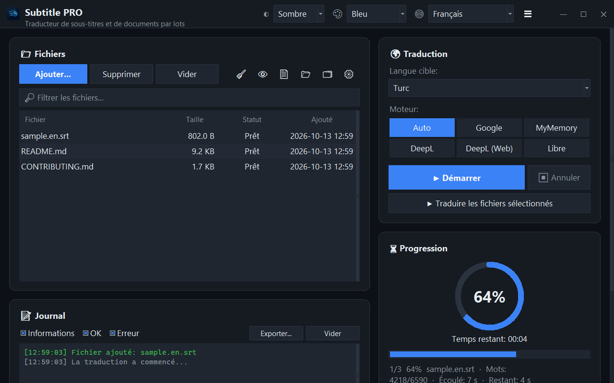

<div align="center">


# Subtitle PRO

**Traduisez des sous-titres et des documents par lots — horodatages, numérotation et retours à la ligne restent intacts.**

[](https://github.com/noms6/subtitle-pro/actions/workflows/tests.yml)    [](../../LICENSE)

🌐 [English](../../README.md) · [Türkçe](README.tr.md) · [Deutsch](README.de.md) · **Français** · [Español](README.es.md) · [Italiano](README.it.md) · [Português](README.pt.md) · [Nederlands](README.nl.md) · [Polski](README.pl.md) · [Svenska](README.sv.md) · [Русский](README.ru.md) · [Українська](README.uk.md) · [العربية](README.ar.md) · [فارسی](README.fa.md) · [हिन्दी](README.hi.md) · [日本語](README.ja.md) · [한국어](README.ko.md) · [中文](README.zh.md) · [Bahasa Indonesia](README.id.md) · [Tiếng Việt](README.vi.md)



</div>

## ✨ Fonctionnalités

- Rapide : un long métrage (≈1 500 lignes) est traduit en environ 12 secondes — les lignes sont envoyées par lots
- Sous-titres : SRT et VTT — numéros, horodatages, `<i>` balises et fins de ligne sont conservés ; sortie UTF-8 lue correctement par les lecteurs Windows
- Documents : TXT, Markdown, CSV, DOCX (corps, tableaux, en-têtes et pieds de page) et PDF (enregistré en PDF ou TXT)
- Moteurs : Google, MyMemory, DeepL API et LibreTranslate — si un service est limité, l’application bascule automatiquement
- File de fichiers avec glisser-déposer, traitement parallèle optionnel, progression et temps restant en direct
- Ignore les fichiers déjà dans la langue cible ; glossaire personnalisé (JSON/CSV) avant ou après la traduction
- Interface en 37 langues, thèmes clair et sombre avec 6 couleurs d’accent ; tous les réglages sont mémorisés
- Aussi en ligne de commande : `python translate_srt.py entree.srt sortie.srt fr`

## 📥 Installation (Windows)

1. Installez [Python 3.10 ou plus récent](https://www.python.org/downloads/) et cochez « Add python.exe to PATH ».
2. Téléchargez le projet ([ZIP](https://github.com/noms6/subtitle-pro/archive/refs/heads/main.zip)) ou clonez-le, puis installez les dépendances :

   ```bash
   py -m pip install -r requirements.txt tkinterdnd2 langdetect
   ```

3. Double-cliquez sur `run_app.bat` ou `Subtitle PRO.pyw` — aucune fenêtre de console ne reste ouverte.

## 🧭 Utilisation

1. Ajoutez des fichiers avec **Ajouter...** ou glissez-les dans la fenêtre.
2. Choisissez la langue cible et un moteur (**Auto** est recommandé).
3. Appuyez sur **▶ Démarrer**. Le résultat est enregistré à côté de l’original, p. ex. `film.en.fr.srt`.
4. Vérifiez le résultat — les noms et interjections comme « Ah ! » restent volontairement inchangés.

## 🖼️ Captures d’écran

<table>
<tr><td align="center"><br>Fenêtre principale</td><td align="center"><br>File vide — déposez vos fichiers ici</td></tr>
<tr><td align="center"><br>Paramètres</td><td align="center"><br>Langues de droite à gauche</td></tr>
</table>

## 📊 État du projet

Développement actif, couvert par plus de 270 tests automatisés. Problèmes connus et feuille de route (en turc) : [KNOWN_ISSUES](../../docs/KNOWN_ISSUES.md) et [ROADMAP](../../docs/ROADMAP.md).

## 🛠️ Développement

Architecture, tests et guide de traduction : voir le [README principal](../../README.md#development).

## 📜 Licence

[MIT](../../LICENSE) © noms6
