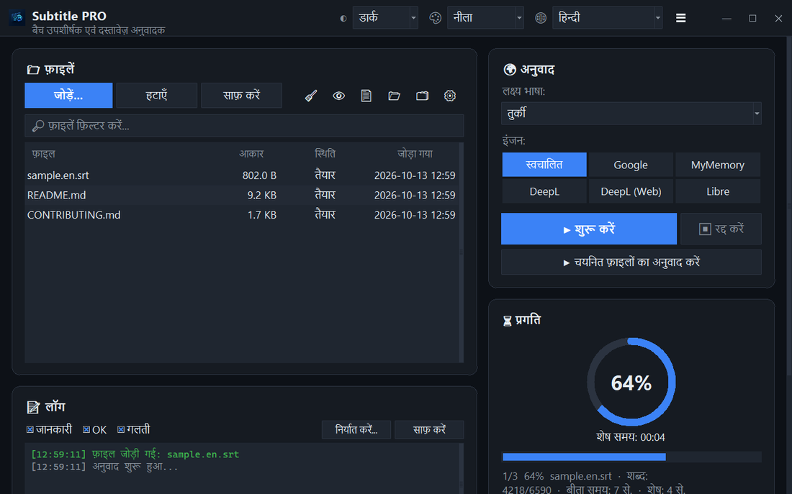

<div align="center">


# Subtitle PRO

**उपशीर्षक और दस्तावेज़ एक साथ अनुवाद करें — टाइमस्टैम्प, क्रमांक और पंक्ति-विराम बिल्कुल वैसे ही रहते हैं।**

[](https://github.com/noms6/subtitle-pro/actions/workflows/tests.yml)    [](../../LICENSE)

🌐 [English](../../README.md) · [Türkçe](README.tr.md) · [Deutsch](README.de.md) · [Français](README.fr.md) · [Español](README.es.md) · [Italiano](README.it.md) · [Português](README.pt.md) · [Nederlands](README.nl.md) · [Polski](README.pl.md) · [Svenska](README.sv.md) · [Русский](README.ru.md) · [Українська](README.uk.md) · [العربية](README.ar.md) · [فارسی](README.fa.md) · **हिन्दी** · [日本語](README.ja.md) · [한국어](README.ko.md) · [中文](README.zh.md) · [Bahasa Indonesia](README.id.md) · [Tiếng Việt](README.vi.md)



</div>

## ✨ सुविधाएँ

- तेज़: पूरी फ़िल्म (≈1,500 पंक्तियाँ) लगभग 12 सेकंड में अनुवादित होती है — पंक्तियाँ बैच में भेजी जाती हैं
- उपशीर्षक: SRT और VTT — क्रमांक, टाइमस्टैम्प, `<i>` टैग और पंक्ति-अंत सुरक्षित रहते हैं; UTF-8 आउटपुट जिसे Windows प्लेयर सही पढ़ते हैं
- दस्तावेज़: TXT, Markdown, CSV, DOCX (मुख्य पाठ, तालिकाएँ, हेडर और फ़ुटर) और PDF (PDF या TXT के रूप में सहेजा जाता है)
- सेवाएँ: Google, MyMemory, DeepL API और LibreTranslate — कोई सेवा सीमित होने पर अपने-आप दूसरी सेवा पर चला जाता है
- ड्रैग-एंड-ड्रॉप वाली फ़ाइल कतार, वैकल्पिक समानांतर प्रोसेसिंग, लाइव प्रगति और शेष समय
- जो फ़ाइलें पहले से लक्ष्य भाषा में हैं उन्हें छोड़ देता है; अनुवाद से पहले या बाद में अपनी शब्दावली (JSON/CSV)
- 37 भाषाओं में इंटरफ़ेस, 6 एक्सेंट रंगों के साथ लाइट और डार्क थीम; सभी सेटिंग्स याद रखी जाती हैं
- कमांड लाइन से भी: `python translate_srt.py input.srt output.srt hi`

## 📥 इंस्टॉलेशन (Windows)

1. [Python 3.10 या नया](https://www.python.org/downloads/) इंस्टॉल करें और “Add python.exe to PATH” चुनें।
2. प्रोजेक्ट डाउनलोड करें ([ZIP](https://github.com/noms6/subtitle-pro/archive/refs/heads/main.zip)) या क्लोन करें, फिर निर्भरताएँ इंस्टॉल करें:

   ```bash
   py -m pip install -r requirements.txt tkinterdnd2 langdetect
   ```

3. `run_app.bat` या `Subtitle PRO.pyw` पर डबल-क्लिक करें — कोई कंसोल विंडो खुली नहीं रहती।

## 🧭 उपयोग कैसे करें

1. **जोड़ें...** से फ़ाइलें जोड़ें या उन्हें विंडो में खींचें।
2. लक्ष्य भाषा और सेवा चुनें (**स्वचालित** की सलाह दी जाती है)।
3. **▶ शुरू करें** दबाएँ। परिणाम मूल फ़ाइल के पास सहेजा जाता है, जैसे `film.en.hi.srt`।
4. परिणाम जाँचें — नाम और “आह!” जैसे विस्मयादिबोधक जानबूझकर नहीं बदले जाते।

## 🖼️ स्क्रीनशॉट

<table>
<tr><td align="center"><br>मुख्य विंडो</td><td align="center"><br>खाली कतार — अपनी फ़ाइलें यहाँ छोड़ें</td></tr>
<tr><td align="center"><br>सेटिंग्स</td><td align="center"><br>दाएँ से बाएँ लिखी जाने वाली भाषाएँ</td></tr>
</table>

## 📊 प्रोजेक्ट की स्थिति

सक्रिय रूप से विकसित और 270 से अधिक स्वचालित परीक्षणों से सुरक्षित। ज्ञात समस्याएँ और रोडमैप (तुर्की में): [KNOWN_ISSUES](../../docs/KNOWN_ISSUES.md) और [ROADMAP](../../docs/ROADMAP.md)।

## 🛠️ विकास

आर्किटेक्चर, परीक्षण और अनुवाद मार्गदर्शिका: [मुख्य README](../../README.md#development) देखें।

## 📜 लाइसेंस

[MIT](../../LICENSE) © noms6
