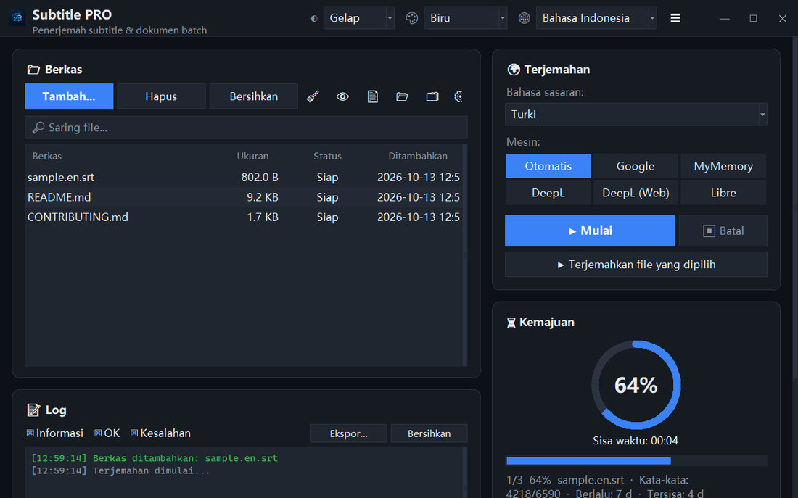

<div align="center">


# Subtitle PRO

**Terjemahkan subtitle dan dokumen sekaligus — stempel waktu, penomoran, dan jeda baris tetap persis seperti semula.**

[](https://github.com/noms6/subtitle-pro/actions/workflows/tests.yml)    [](../../LICENSE)

🌐 [English](../../README.md) · [Türkçe](README.tr.md) · [Deutsch](README.de.md) · [Français](README.fr.md) · [Español](README.es.md) · [Italiano](README.it.md) · [Português](README.pt.md) · [Nederlands](README.nl.md) · [Polski](README.pl.md) · [Svenska](README.sv.md) · [Русский](README.ru.md) · [Українська](README.uk.md) · [العربية](README.ar.md) · [فارسی](README.fa.md) · [हिन्दी](README.hi.md) · [日本語](README.ja.md) · [한국어](README.ko.md) · [中文](README.zh.md) · **Bahasa Indonesia** · [Tiếng Việt](README.vi.md)



</div>

## ✨ Fitur

- Cepat: satu film penuh (≈1.500 baris) diterjemahkan dalam sekitar 12 detik — baris dikirim per kelompok
- Subtitle: SRT dan VTT — nomor, stempel waktu, `<i>` tag, dan akhir baris dipertahankan; keluaran UTF-8 yang dibaca dengan benar oleh pemutar Windows
- Dokumen: TXT, Markdown, CSV, DOCX (isi, tabel, header dan footer) serta PDF (disimpan sebagai PDF atau TXT)
- Layanan: Google, MyMemory, DeepL API, dan LibreTranslate — jika satu layanan dibatasi, aplikasi otomatis beralih ke layanan lain
- Antrean berkas dengan seret dan lepas, pemrosesan paralel opsional, kemajuan dan sisa waktu secara langsung
- Melewati berkas yang sudah dalam bahasa tujuan; glosarium sendiri (JSON/CSV) sebelum atau sesudah penerjemahan
- Antarmuka dalam 37 bahasa, tema terang dan gelap dengan 6 warna aksen; semua pengaturan diingat
- Juga lewat baris perintah: `python translate_srt.py input.srt output.srt id`

## 📥 Instalasi (Windows)

1. Instal [Python 3.10 atau lebih baru](https://www.python.org/downloads/) dan centang “Add python.exe to PATH”.
2. Unduh proyek ([ZIP](https://github.com/noms6/subtitle-pro/archive/refs/heads/main.zip)) atau kloning, lalu instal dependensinya:

   ```bash
   py -m pip install -r requirements.txt tkinterdnd2 langdetect
   ```

3. Klik dua kali `run_app.bat` atau `Subtitle PRO.pyw` — tidak ada jendela konsol yang tertinggal.

## 🧭 Cara menggunakan

1. Tambahkan berkas dengan **Tambah...** atau seret ke jendela.
2. Pilih bahasa tujuan dan layanan (**Otomatis** disarankan).
3. Tekan **▶ Mulai**. Hasil disimpan di samping berkas asli, mis. `film.en.id.srt`.
4. Periksa hasilnya — nama dan seruan seperti “Ah!” sengaja dibiarkan tidak berubah.

## 🖼️ Tangkapan layar

<table>
<tr><td align="center"><br>Jendela utama</td><td align="center"><br>Antrean kosong — letakkan berkas di sini</td></tr>
<tr><td align="center"><br>Pengaturan</td><td align="center"><br>Bahasa yang ditulis dari kanan ke kiri</td></tr>
</table>

## 📊 Status proyek

Dikembangkan secara aktif dan dilindungi lebih dari 270 pengujian otomatis. Masalah yang diketahui dan peta jalan (bahasa Turki): [KNOWN_ISSUES](../../docs/KNOWN_ISSUES.md) dan [ROADMAP](../../docs/ROADMAP.md).

## 🛠️ Pengembangan

Arsitektur, pengujian, dan panduan terjemahan: lihat [README utama](../../README.md#development).

## 📜 Lisensi

[MIT](../../LICENSE) © noms6
