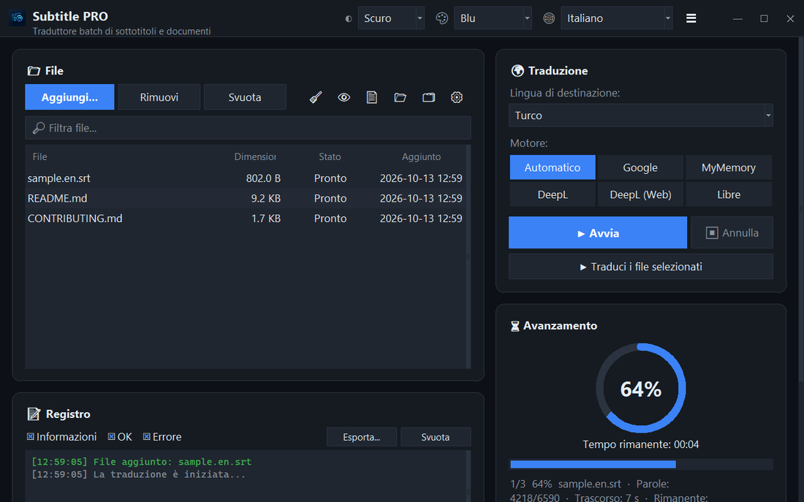

<div align="center">


# Subtitle PRO

**Traduci sottotitoli e documenti in blocco — timestamp, numerazione e a capo restano esattamente come sono.**

[](https://github.com/noms6/subtitle-pro/actions/workflows/tests.yml)    [](../../LICENSE)

🌐 [English](../../README.md) · [Türkçe](README.tr.md) · [Deutsch](README.de.md) · [Français](README.fr.md) · [Español](README.es.md) · **Italiano** · [Português](README.pt.md) · [Nederlands](README.nl.md) · [Polski](README.pl.md) · [Svenska](README.sv.md) · [Русский](README.ru.md) · [Українська](README.uk.md) · [العربية](README.ar.md) · [فارسی](README.fa.md) · [हिन्दी](README.hi.md) · [日本語](README.ja.md) · [한국어](README.ko.md) · [中文](README.zh.md) · [Bahasa Indonesia](README.id.md) · [Tiếng Việt](README.vi.md)



</div>

## ✨ Funzionalità

- Veloce: un film intero (≈1.500 righe) viene tradotto in circa 12 secondi — le righe vengono inviate a blocchi
- Sottotitoli: SRT e VTT — numeri, timestamp, `<i>` tag e fine riga vengono mantenuti; output UTF-8 letto correttamente dai player di Windows
- Documenti: TXT, Markdown, CSV, DOCX (testo, tabelle, intestazioni e piè di pagina) e PDF (salvato come PDF o TXT)
- Motori: Google, MyMemory, DeepL API e LibreTranslate — se un servizio viene limitato passa automaticamente a un altro
- Coda di file con trascinamento, elaborazione parallela opzionale, avanzamento e tempo rimanente in tempo reale
- Salta i file già nella lingua di destinazione; glossario personalizzato (JSON/CSV) prima o dopo la traduzione
- Interfaccia in 37 lingue, tema chiaro e scuro con 6 colori principali; tutte le impostazioni vengono ricordate
- Anche da riga di comando: `python translate_srt.py input.srt output.srt it`

## 📥 Installazione (Windows)

1. Installa [Python 3.10 o successivo](https://www.python.org/downloads/) e spunta “Add python.exe to PATH”.
2. Scarica il progetto ([ZIP](https://github.com/noms6/subtitle-pro/archive/refs/heads/main.zip)) o clonalo, poi installa le dipendenze:

   ```bash
   py -m pip install -r requirements.txt tkinterdnd2 langdetect
   ```

3. Fai doppio clic su `run_app.bat` o `Subtitle PRO.pyw` — nessuna finestra di console resta aperta.

## 🧭 Come si usa

1. Aggiungi file con **Aggiungi...** o trascinali nella finestra.
2. Scegli la lingua di destinazione e un motore (si consiglia **Automatico**).
3. Premi **▶ Avvia**. Il risultato viene salvato accanto all’originale, ad es. `film.en.it.srt`.
4. Controlla il risultato — nomi e interiezioni come “Ah!” restano invariati di proposito.

## 🖼️ Screenshot

<table>
<tr><td align="center"><br>Finestra principale</td><td align="center"><br>Coda vuota — trascina qui i file</td></tr>
<tr><td align="center"><br>Impostazioni</td><td align="center"><br>Lingue da destra a sinistra</td></tr>
</table>

## 📊 Stato del progetto

In sviluppo attivo e coperto da oltre 270 test automatici. Problemi noti e roadmap (in turco): [KNOWN_ISSUES](../../docs/KNOWN_ISSUES.md) e [ROADMAP](../../docs/ROADMAP.md).

## 🛠️ Sviluppo

Architettura, test e guida alla traduzione: vedi il [README principale](../../README.md#development).

## 📜 Licenza

[MIT](../../LICENSE) © noms6
