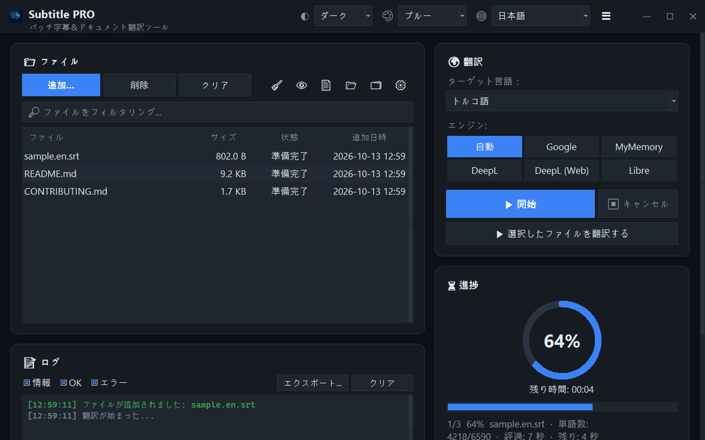

<div align="center">


# Subtitle PRO

**字幕とドキュメントを一括翻訳 — タイムスタンプ、番号、改行はそのまま保たれます。**

[](https://github.com/noms6/subtitle-pro/actions/workflows/tests.yml)    [](../../LICENSE)

🌐 [English](../../README.md) · [Türkçe](README.tr.md) · [Deutsch](README.de.md) · [Français](README.fr.md) · [Español](README.es.md) · [Italiano](README.it.md) · [Português](README.pt.md) · [Nederlands](README.nl.md) · [Polski](README.pl.md) · [Svenska](README.sv.md) · [Русский](README.ru.md) · [Українська](README.uk.md) · [العربية](README.ar.md) · [فارسی](README.fa.md) · [हिन्दी](README.hi.md) · **日本語** · [한국어](README.ko.md) · [中文](README.zh.md) · [Bahasa Indonesia](README.id.md) · [Tiếng Việt](README.vi.md)



</div>

## ✨ 特長

- 高速：映画1本分（約1,500行）を約12秒で翻訳 — 行はまとめて送信されます
- 字幕：SRT と VTT — 番号、タイムスタンプ、`<i>` タグ、改行コードを保持。Windows のプレーヤーで正しく読める UTF-8 で出力
- ドキュメント：TXT、Markdown、CSV、DOCX（本文、表、ヘッダー・フッター）、PDF（PDF または TXT で保存）
- 翻訳サービス：Google、MyMemory、DeepL API、LibreTranslate — 制限を受けると自動で別のサービスに切り替え
- ドラッグ＆ドロップ対応のファイルキュー、並列処理（任意）、リアルタイムの進捗と残り時間
- すでに翻訳先の言語で書かれたファイルはスキップ。翻訳の前または後に適用するカスタム用語集（JSON/CSV）
- 37言語の UI、6種類のアクセントカラーを選べるライト/ダークテーマ。設定はすべて保存されます
- コマンドラインでも：`python translate_srt.py input.srt output.srt ja`

## 📥 インストール（Windows）

1. [Python 3.10 以降](https://www.python.org/downloads/)をインストールし、「Add python.exe to PATH」にチェックを入れます。
2. プロジェクトをダウンロード（[ZIP](https://github.com/noms6/subtitle-pro/archive/refs/heads/main.zip)）またはクローンし、依存関係をインストールします：

   ```bash
   py -m pip install -r requirements.txt tkinterdnd2 langdetect
   ```

3. `run_app.bat` または `Subtitle PRO.pyw` をダブルクリック — コンソールウィンドウは残りません。

## 🧭 使い方

1. **追加...** でファイルを選ぶか、ウィンドウにドラッグします。
2. 翻訳先の言語とサービスを選びます（**自動** がおすすめ）。
3. **▶ 開始** を押します。結果は元のファイルの隣に保存されます（例：`film.en.ja.srt`）。
4. 結果を確認します — 人名や「Ah!」のような感嘆詞は意図的にそのまま残ります。

## 🖼️ スクリーンショット

<table>
<tr><td align="center"><br>メインウィンドウ</td><td align="center"><br>空のキュー — ここにファイルをドロップ</td></tr>
<tr><td align="center"><br>設定</td><td align="center"><br>右から左に書く言語</td></tr>
</table>

## 📊 プロジェクトの状況

活発に開発中で、270 以上の自動テストで保護されています。既知の問題とロードマップ（トルコ語）：[KNOWN_ISSUES](../../docs/KNOWN_ISSUES.md)、[ROADMAP](../../docs/ROADMAP.md)。

## 🛠️ 開発

アーキテクチャ、テスト、翻訳ガイドは[メインの README](../../README.md#development)をご覧ください。

## 📜 ライセンス

[MIT](../../LICENSE) © noms6
