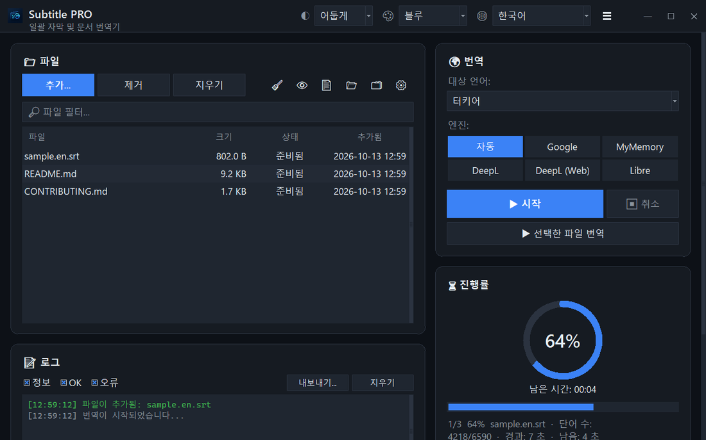

<div align="center">


# Subtitle PRO

**자막과 문서를 한 번에 번역 — 타임스탬프, 번호, 줄바꿈이 그대로 유지됩니다.**

[](https://github.com/noms6/subtitle-pro/actions/workflows/tests.yml)    [](../../LICENSE)

🌐 [English](../../README.md) · [Türkçe](README.tr.md) · [Deutsch](README.de.md) · [Français](README.fr.md) · [Español](README.es.md) · [Italiano](README.it.md) · [Português](README.pt.md) · [Nederlands](README.nl.md) · [Polski](README.pl.md) · [Svenska](README.sv.md) · [Русский](README.ru.md) · [Українська](README.uk.md) · [العربية](README.ar.md) · [فارسی](README.fa.md) · [हिन्दी](README.hi.md) · [日本語](README.ja.md) · **한국어** · [中文](README.zh.md) · [Bahasa Indonesia](README.id.md) · [Tiếng Việt](README.vi.md)



</div>

## ✨ 기능

- 빠름: 영화 한 편(약 1,500줄)을 약 12초 만에 번역 — 줄을 묶어서 전송합니다
- 자막: SRT와 VTT — 번호, 타임스탬프, `<i>` 태그, 줄 끝을 유지하며 Windows 플레이어가 올바르게 읽는 UTF-8로 저장
- 문서: TXT, Markdown, CSV, DOCX(본문, 표, 머리글/바닥글), PDF(PDF 또는 TXT로 저장)
- 번역 서비스: Google, MyMemory, DeepL API, LibreTranslate — 서비스가 제한되면 자동으로 다른 서비스로 전환
- 끌어서 놓기를 지원하는 파일 대기열, 선택적 병렬 처리, 실시간 진행률과 남은 시간
- 이미 대상 언어로 된 파일은 건너뜀. 번역 전이나 후에 적용하는 사용자 용어집(JSON/CSV)
- 37개 언어 UI, 6가지 강조 색이 있는 밝은/어두운 테마. 모든 설정이 저장됩니다
- 명령줄에서도: `python translate_srt.py input.srt output.srt ko`

## 📥 설치 (Windows)

1. [Python 3.10 이상](https://www.python.org/downloads/)을 설치하고 “Add python.exe to PATH”를 체크하세요.
2. 프로젝트를 다운로드([ZIP](https://github.com/noms6/subtitle-pro/archive/refs/heads/main.zip))하거나 클론한 뒤 의존성을 설치하세요:

   ```bash
   py -m pip install -r requirements.txt tkinterdnd2 langdetect
   ```

3. `run_app.bat` 또는 `Subtitle PRO.pyw`를 더블클릭하세요 — 콘솔 창이 남지 않습니다.

## 🧭 사용 방법

1. **추가...**로 파일을 추가하거나 창으로 끌어 놓으세요.
2. 대상 언어와 번역 서비스를 고르세요(**자동** 권장).
3. **▶ 시작**을 누르세요. 결과는 원본 옆에 저장됩니다. 예: `film.en.ko.srt`
4. 결과를 확인하세요 — 이름과 “Ah!” 같은 감탄사는 일부러 그대로 둡니다.

## 🖼️ 스크린샷

<table>
<tr><td align="center"><br>메인 창</td><td align="center"><br>빈 대기열 — 여기에 파일을 놓으세요</td></tr>
<tr><td align="center"><br>설정</td><td align="center"><br>오른쪽에서 왼쪽으로 쓰는 언어</td></tr>
</table>

## 📊 프로젝트 상태

활발히 개발 중이며 270개 이상의 자동 테스트로 검증됩니다. 알려진 문제와 로드맵(터키어): [KNOWN_ISSUES](../../docs/KNOWN_ISSUES.md), [ROADMAP](../../docs/ROADMAP.md).

## 🛠️ 개발

아키텍처, 테스트, 번역 가이드는 [메인 README](../../README.md#development)를 참고하세요.

## 📜 라이선스

[MIT](../../LICENSE) © noms6
