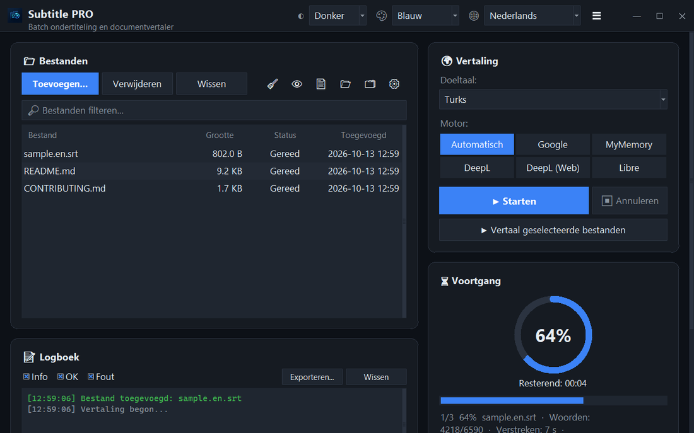

<div align="center">


# Subtitle PRO

**Vertaal ondertitels en documenten in één keer — tijdcodes, nummering en regeleinden blijven precies zoals ze waren.**

[](https://github.com/noms6/subtitle-pro/actions/workflows/tests.yml)    [](../../LICENSE)

🌐 [English](../../README.md) · [Türkçe](README.tr.md) · [Deutsch](README.de.md) · [Français](README.fr.md) · [Español](README.es.md) · [Italiano](README.it.md) · [Português](README.pt.md) · **Nederlands** · [Polski](README.pl.md) · [Svenska](README.sv.md) · [Русский](README.ru.md) · [Українська](README.uk.md) · [العربية](README.ar.md) · [فارسی](README.fa.md) · [हिन्दी](README.hi.md) · [日本語](README.ja.md) · [한국어](README.ko.md) · [中文](README.zh.md) · [Bahasa Indonesia](README.id.md) · [Tiếng Việt](README.vi.md)



</div>

## ✨ Functies

- Snel: een complete film (≈1.500 regels) is in ongeveer 12 seconden vertaald — regels worden in blokken verstuurd
- Ondertitels: SRT en VTT — nummers, tijdcodes, `<i>` tags en regeleinden blijven behouden; UTF-8-uitvoer die Windows-spelers correct lezen
- Documenten: TXT, Markdown, CSV, DOCX (tekst, tabellen, kop- en voetteksten) en PDF (opgeslagen als PDF of TXT)
- Diensten: Google, MyMemory, DeepL API en LibreTranslate — wordt een dienst beperkt, dan wordt automatisch overgeschakeld
- Bestandswachtrij met slepen en neerzetten, optioneel parallel verwerken, live voortgang en resterende tijd
- Slaat bestanden over die al in de doeltaal zijn; eigen woordenlijst (JSON/CSV) voor of na het vertalen
- Interface in 37 talen, licht en donker thema met 6 accentkleuren; alle instellingen worden onthouden
- Ook via de opdrachtregel: `python translate_srt.py invoer.srt uitvoer.srt nl`

## 📥 Installatie (Windows)

1. Installeer [Python 3.10 of nieuwer](https://www.python.org/downloads/) en vink “Add python.exe to PATH” aan.
2. Download het project ([ZIP](https://github.com/noms6/subtitle-pro/archive/refs/heads/main.zip)) of kloon het en installeer daarna de afhankelijkheden:

   ```bash
   py -m pip install -r requirements.txt tkinterdnd2 langdetect
   ```

3. Dubbelklik op `run_app.bat` of `Subtitle PRO.pyw` — er blijft geen consolevenster open.

## 🧭 Gebruik

1. Voeg bestanden toe met **Toevoegen...** of sleep ze naar het venster.
2. Kies de doeltaal en een dienst (**Automatisch** wordt aanbevolen).
3. Druk op **▶ Starten**. Het resultaat wordt naast het origineel opgeslagen, bijv. `film.en.nl.srt`.
4. Controleer het resultaat — namen en tussenwerpsels zoals “Ah!” blijven bewust ongewijzigd.

## 🖼️ Schermafbeeldingen

<table>
<tr><td align="center"><br>Hoofdvenster</td><td align="center"><br>Lege wachtrij — sleep je bestanden hierheen</td></tr>
<tr><td align="center"><br>Instellingen</td><td align="center"><br>Talen van rechts naar links</td></tr>
</table>

## 📊 Projectstatus

Wordt actief ontwikkeld en afgedekt door meer dan 270 geautomatiseerde tests. Bekende problemen en roadmap (in het Turks): [KNOWN_ISSUES](../../docs/KNOWN_ISSUES.md) en [ROADMAP](../../docs/ROADMAP.md).

## 🛠️ Ontwikkeling

Architectuur, tests en vertaalgids: zie de [hoofd-README](../../README.md#development).

## 📜 Licentie

[MIT](../../LICENSE) © noms6
