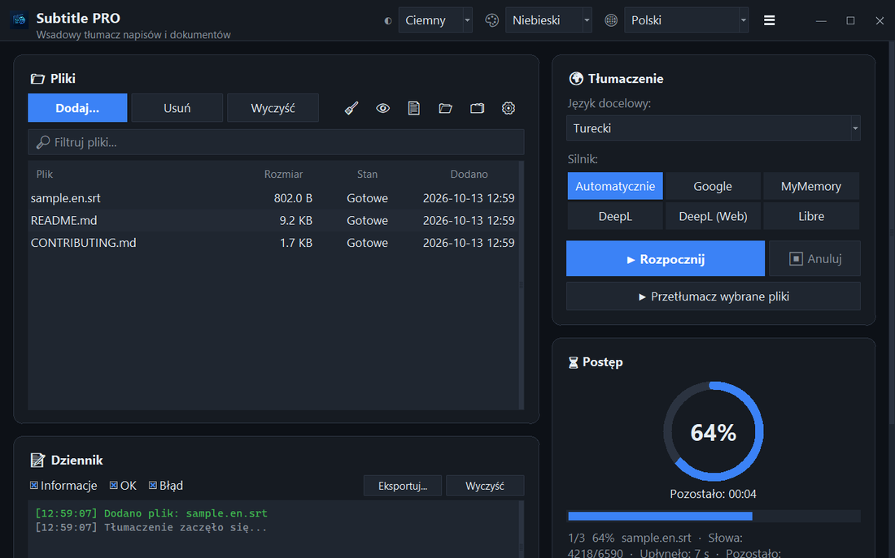

<div align="center">


# Subtitle PRO

**Tłumacz napisy i dokumenty hurtowo — znaczniki czasu, numeracja i podziały wierszy pozostają dokładnie takie same.**

[](https://github.com/noms6/subtitle-pro/actions/workflows/tests.yml)    [](../../LICENSE)

🌐 [English](../../README.md) · [Türkçe](README.tr.md) · [Deutsch](README.de.md) · [Français](README.fr.md) · [Español](README.es.md) · [Italiano](README.it.md) · [Português](README.pt.md) · [Nederlands](README.nl.md) · **Polski** · [Svenska](README.sv.md) · [Русский](README.ru.md) · [Українська](README.uk.md) · [العربية](README.ar.md) · [فارسی](README.fa.md) · [हिन्दी](README.hi.md) · [日本語](README.ja.md) · [한국어](README.ko.md) · [中文](README.zh.md) · [Bahasa Indonesia](README.id.md) · [Tiếng Việt](README.vi.md)



</div>

## ✨ Funkcje

- Szybko: cały film (≈1500 wierszy) zostaje przetłumaczony w około 12 sekund — wiersze są wysyłane paczkami
- Napisy: SRT i VTT — numery, znaczniki czasu, `<i>` tagi i końce wierszy są zachowane; wynik w UTF-8 poprawnie odczytywany przez odtwarzacze w Windows
- Dokumenty: TXT, Markdown, CSV, DOCX (treść, tabele, nagłówki i stopki) oraz PDF (zapis jako PDF lub TXT)
- Usługi: Google, MyMemory, DeepL API i LibreTranslate — gdy usługa zostanie ograniczona, program automatycznie przełącza się na inną
- Kolejka plików z przeciąganiem i upuszczaniem, opcjonalne przetwarzanie równoległe, postęp i pozostały czas na żywo
- Pomija pliki, które są już w języku docelowym; własny słownik (JSON/CSV) przed lub po tłumaczeniu
- Interfejs w 37 językach, jasny i ciemny motyw z 6 kolorami akcentu; wszystkie ustawienia są zapamiętywane
- Także z wiersza poleceń: `python translate_srt.py wejscie.srt wyjscie.srt pl`

## 📥 Instalacja (Windows)

1. Zainstaluj [Pythona 3.10 lub nowszego](https://www.python.org/downloads/) i zaznacz „Add python.exe to PATH”.
2. Pobierz projekt ([ZIP](https://github.com/noms6/subtitle-pro/archive/refs/heads/main.zip)) lub sklonuj go, a następnie zainstaluj zależności:

   ```bash
   py -m pip install -r requirements.txt tkinterdnd2 langdetect
   ```

3. Kliknij dwukrotnie `run_app.bat` lub `Subtitle PRO.pyw` — nie zostaje otwarte żadne okno konsoli.

## 🧭 Jak używać

1. Dodaj pliki przyciskiem **Dodaj...** lub przeciągnij je do okna.
2. Wybierz język docelowy i usługę (zalecane **Automatycznie**).
3. Naciśnij **▶ Rozpocznij**. Wynik zapisuje się obok oryginału, np. `film.en.pl.srt`.
4. Sprawdź wynik — imiona i wykrzyknienia takie jak „Ach!” celowo pozostają bez zmian.

## 🖼️ Zrzuty ekranu

<table>
<tr><td align="center"><br>Okno główne</td><td align="center"><br>Pusta kolejka — upuść tutaj pliki</td></tr>
<tr><td align="center"><br>Ustawienia</td><td align="center"><br>Języki pisane od prawej do lewej</td></tr>
</table>

## 📊 Stan projektu

Aktywnie rozwijany i objęty ponad 270 testami automatycznymi. Znane problemy i plan rozwoju (po turecku): [KNOWN_ISSUES](../../docs/KNOWN_ISSUES.md) i [ROADMAP](../../docs/ROADMAP.md).

## 🛠️ Rozwój

Architektura, testy i przewodnik po tłumaczeniach: zobacz [główny README](../../README.md#development).

## 📜 Licencja

[MIT](../../LICENSE) © noms6
