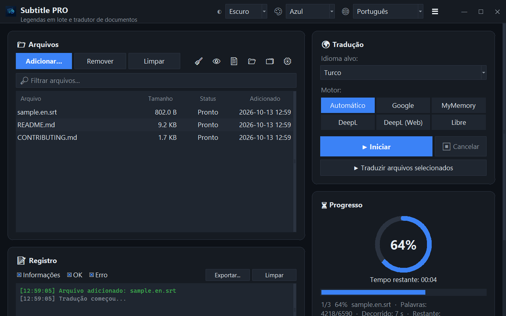

<div align="center">


# Subtitle PRO

**Traduza legendas e documentos em lote — marcas de tempo, numeração e quebras de linha ficam exatamente como estavam.**

[](https://github.com/noms6/subtitle-pro/actions/workflows/tests.yml)    [](../../LICENSE)

🌐 [English](../../README.md) · [Türkçe](README.tr.md) · [Deutsch](README.de.md) · [Français](README.fr.md) · [Español](README.es.md) · [Italiano](README.it.md) · **Português** · [Nederlands](README.nl.md) · [Polski](README.pl.md) · [Svenska](README.sv.md) · [Русский](README.ru.md) · [Українська](README.uk.md) · [العربية](README.ar.md) · [فارسی](README.fa.md) · [हिन्दी](README.hi.md) · [日本語](README.ja.md) · [한국어](README.ko.md) · [中文](README.zh.md) · [Bahasa Indonesia](README.id.md) · [Tiếng Việt](README.vi.md)



</div>

## ✨ Recursos

- Rápido: um filme inteiro (≈1.500 linhas) é traduzido em cerca de 12 segundos — as linhas são enviadas em lotes
- Legendas: SRT e VTT — números, marcas de tempo, `<i>` tags e finais de linha são preservados; saída UTF-8 lida corretamente pelos players do Windows
- Documentos: TXT, Markdown, CSV, DOCX (corpo, tabelas, cabeçalhos e rodapés) e PDF (salvo como PDF ou TXT)
- Serviços: Google, MyMemory, DeepL API e LibreTranslate — se um serviço for limitado, troca automaticamente para outro
- Fila de arquivos com arrastar e soltar, processamento paralelo opcional, progresso e tempo restante ao vivo
- Ignora arquivos que já estão no idioma de destino; glossário próprio (JSON/CSV) antes ou depois da tradução
- Interface em 37 idiomas, temas claro e escuro com 6 cores de destaque; todas as configurações são lembradas
- Também pela linha de comando: `python translate_srt.py entrada.srt saida.srt pt`

## 📥 Instalação (Windows)

1. Instale o [Python 3.10 ou mais recente](https://www.python.org/downloads/) e marque “Add python.exe to PATH”.
2. Baixe o projeto ([ZIP](https://github.com/noms6/subtitle-pro/archive/refs/heads/main.zip)) ou clone-o e instale as dependências:

   ```bash
   py -m pip install -r requirements.txt tkinterdnd2 langdetect
   ```

3. Clique duas vezes em `run_app.bat` ou `Subtitle PRO.pyw` — nenhuma janela de console fica aberta.

## 🧭 Como usar

1. Adicione arquivos com **Adicionar...** ou arraste-os para a janela.
2. Escolha o idioma de destino e um serviço (**Automático** é o recomendado).
3. Pressione **▶ Iniciar**. O resultado é salvo ao lado do original, ex.: `filme.en.pt.srt`.
4. Confira o resultado — nomes e interjeições como “Ah!” ficam inalterados de propósito.

## 🖼️ Capturas de tela

<table>
<tr><td align="center"><br>Janela principal</td><td align="center"><br>Fila vazia — solte seus arquivos aqui</td></tr>
<tr><td align="center"><br>Configurações</td><td align="center"><br>Idiomas da direita para a esquerda</td></tr>
</table>

## 📊 Status do projeto

Em desenvolvimento ativo e coberto por mais de 270 testes automatizados. Problemas conhecidos e roteiro (em turco): [KNOWN_ISSUES](../../docs/KNOWN_ISSUES.md) e [ROADMAP](../../docs/ROADMAP.md).

## 🛠️ Desenvolvimento

Arquitetura, testes e guia de tradução: veja o [README principal](../../README.md#development).

## 📜 Licença

[MIT](../../LICENSE) © noms6
