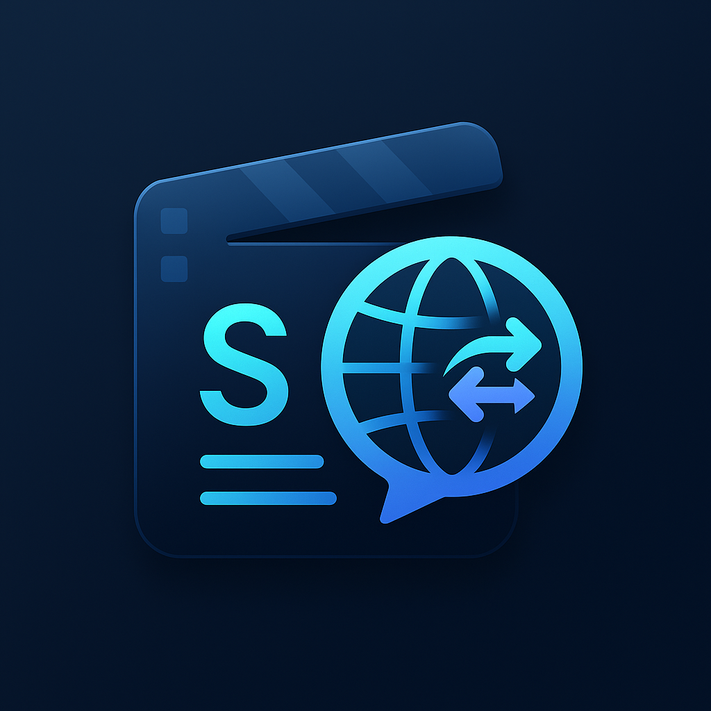
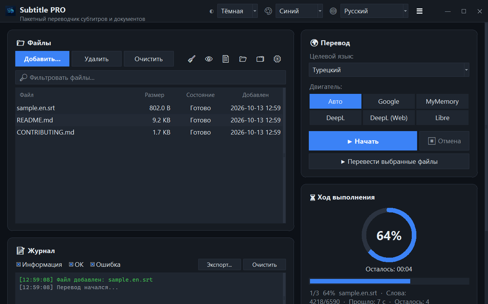
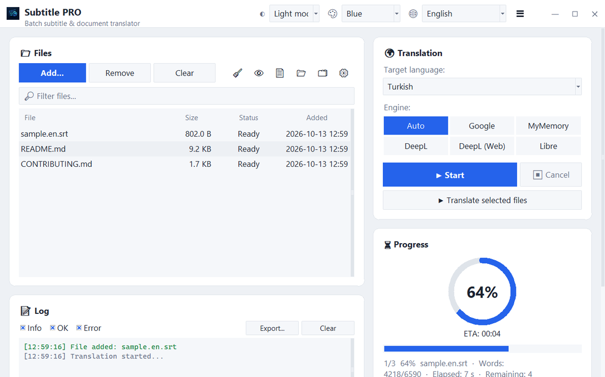
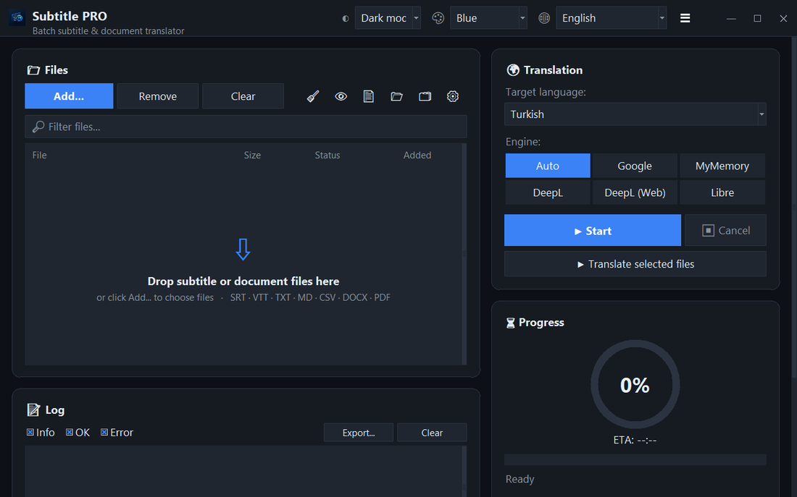
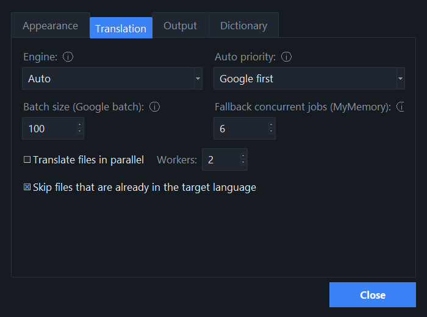
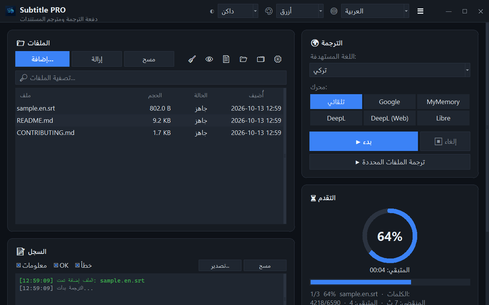

<div align="center">



# Subtitle PRO

**Пакетный перевод субтитров и документов — таймкоды, нумерация и переносы строк остаются в точности как были.**

[](https://github.com/noms6/subtitle-pro/actions/workflows/tests.yml)    [](../../LICENSE)

🌐 [English](../../README.md) · [Türkçe](README.tr.md) · [Deutsch](README.de.md) · [Français](README.fr.md) · [Español](README.es.md) · [Italiano](README.it.md) · [Português](README.pt.md) · [Nederlands](README.nl.md) · [Polski](README.pl.md) · [Svenska](README.sv.md) · **Русский** · [Українська](README.uk.md) · [العربية](README.ar.md) · [فارسی](README.fa.md) · [हिन्दी](README.hi.md) · [日本語](README.ja.md) · [한국어](README.ko.md) · [中文](README.zh.md) · [Bahasa Indonesia](README.id.md) · [Tiếng Việt](README.vi.md)



</div>

## ✨ Возможности

- Быстро: полнометражный фильм (≈1500 строк) переводится примерно за 12 секунд — строки отправляются пакетами
- Субтитры: SRT и VTT — номера, таймкоды, `<i>` теги и концы строк сохраняются; вывод в UTF-8, который правильно читают плееры Windows
- Документы: TXT, Markdown, CSV, DOCX (текст, таблицы, колонтитулы) и PDF (сохраняется как PDF или TXT)
- Сервисы: Google, MyMemory, DeepL API и LibreTranslate — если сервис ограничивает запросы, программа автоматически переключается на другой
- Очередь файлов с перетаскиванием, необязательная параллельная обработка, прогресс и оставшееся время в реальном времени
- Пропускает файлы, уже написанные на целевом языке; собственный глоссарий (JSON/CSV) до или после перевода
- Интерфейс на 37 языках, светлая и тёмная темы с 6 акцентными цветами; все настройки запоминаются
- Также из командной строки: `python translate_srt.py input.srt output.srt ru`

## 📥 Установка (Windows)

1. Установите [Python 3.10 или новее](https://www.python.org/downloads/) и отметьте «Add python.exe to PATH».
2. Скачайте проект ([ZIP](https://github.com/noms6/subtitle-pro/archive/refs/heads/main.zip)) или клонируйте его, затем установите зависимости:

   ```bash
   py -m pip install -r requirements.txt tkinterdnd2 langdetect
   ```

3. Дважды щёлкните `run_app.bat` или `Subtitle PRO.pyw` — окно консоли не остаётся открытым.

## 🧭 Как пользоваться

1. Добавьте файлы кнопкой **Добавить...** или перетащите их в окно.
2. Выберите целевой язык и сервис (рекомендуется **Авто**).
3. Нажмите **▶ Начать**. Результат сохраняется рядом с оригиналом, например `film.en.ru.srt`.
4. Проверьте результат — имена и междометия вроде «Ах!» намеренно не изменяются.

## 🖼️ Скриншоты

<table>
<tr><td align="center"><br>Главное окно</td><td align="center"><br>Пустая очередь — перетащите файлы сюда</td></tr>
<tr><td align="center"><br>Настройки</td><td align="center"><br>Языки с письмом справа налево</td></tr>
</table>

## 📊 Состояние проекта

Активно развивается и покрыт более чем 270 автотестами. Известные проблемы и план развития (на турецком): [KNOWN_ISSUES](../../docs/KNOWN_ISSUES.md) и [ROADMAP](../../docs/ROADMAP.md).

## 🛠️ Разработка

Архитектура, тесты и руководство по переводу: см. [основной README](../../README.md#development).

## 📜 Лицензия

[MIT](../../LICENSE) © noms6
