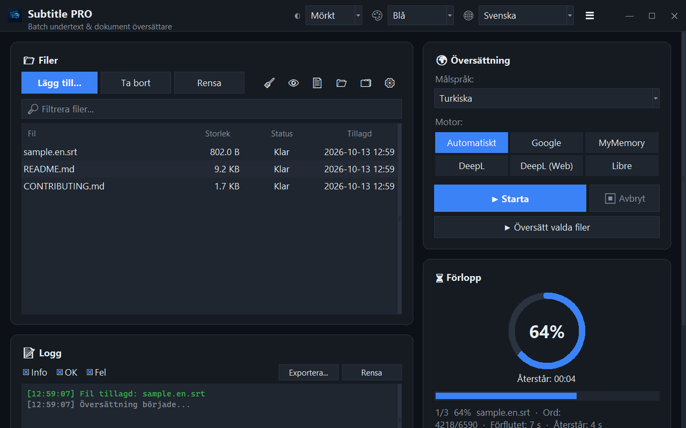

<div align="center">


# Subtitle PRO

**Översätt undertexter och dokument i omgångar — tidskoder, numrering och radbrytningar förblir exakt som de var.**

[](https://github.com/noms6/subtitle-pro/actions/workflows/tests.yml)    [](../../LICENSE)

🌐 [English](../../README.md) · [Türkçe](README.tr.md) · [Deutsch](README.de.md) · [Français](README.fr.md) · [Español](README.es.md) · [Italiano](README.it.md) · [Português](README.pt.md) · [Nederlands](README.nl.md) · [Polski](README.pl.md) · **Svenska** · [Русский](README.ru.md) · [Українська](README.uk.md) · [العربية](README.ar.md) · [فارسی](README.fa.md) · [हिन्दी](README.hi.md) · [日本語](README.ja.md) · [한국어](README.ko.md) · [中文](README.zh.md) · [Bahasa Indonesia](README.id.md) · [Tiếng Việt](README.vi.md)



</div>

## ✨ Funktioner

- Snabbt: en hel långfilm (≈1 500 rader) översätts på cirka 12 sekunder — raderna skickas i omgångar
- Undertexter: SRT och VTT — nummer, tidskoder, `<i>` taggar och radslut bevaras; UTF-8-utdata som Windows-spelare läser korrekt
- Dokument: TXT, Markdown, CSV, DOCX (brödtext, tabeller, sidhuvuden och sidfötter) och PDF (sparas som PDF eller TXT)
- Tjänster: Google, MyMemory, DeepL API och LibreTranslate — om en tjänst begränsas byter programmet automatiskt
- Filkö med dra och släpp, valfri parallell bearbetning, förlopp och återstående tid i realtid
- Hoppar över filer som redan är på målspråket; egen ordlista (JSON/CSV) före eller efter översättningen
- Gränssnitt på 37 språk, ljust och mörkt tema med 6 accentfärger; alla inställningar sparas
- Även från kommandoraden: `python translate_srt.py in.srt ut.srt sv`

## 📥 Installation (Windows)

1. Installera [Python 3.10 eller senare](https://www.python.org/downloads/) och kryssa i ”Add python.exe to PATH”.
2. Ladda ner projektet ([ZIP](https://github.com/noms6/subtitle-pro/archive/refs/heads/main.zip)) eller klona det och installera sedan beroendena:

   ```bash
   py -m pip install -r requirements.txt tkinterdnd2 langdetect
   ```

3. Dubbelklicka på `run_app.bat` eller `Subtitle PRO.pyw` — inget konsolfönster blir kvar.

## 🧭 Användning

1. Lägg till filer med **Lägg till...** eller dra dem till fönstret.
2. Välj målspråk och tjänst (**Automatiskt** rekommenderas).
3. Tryck på **▶ Starta**. Resultatet sparas bredvid originalet, t.ex. `film.en.sv.srt`.
4. Kontrollera resultatet — namn och interjektioner som ”Ah!” lämnas avsiktligt oförändrade.

## 🖼️ Skärmbilder

<table>
<tr><td align="center"><br>Huvudfönster</td><td align="center"><br>Tom kö — släpp dina filer här</td></tr>
<tr><td align="center"><br>Inställningar</td><td align="center"><br>Språk som skrivs från höger till vänster</td></tr>
</table>

## 📊 Projektstatus

Utvecklas aktivt och täcks av över 270 automatiska tester. Kända problem och färdplan (på turkiska): [KNOWN_ISSUES](../../docs/KNOWN_ISSUES.md) och [ROADMAP](../../docs/ROADMAP.md).

## 🛠️ Utveckling

Arkitektur, tester och översättningsguide: se [huvud-README](../../README.md#development).

## 📜 Licens

[MIT](../../LICENSE) © noms6
