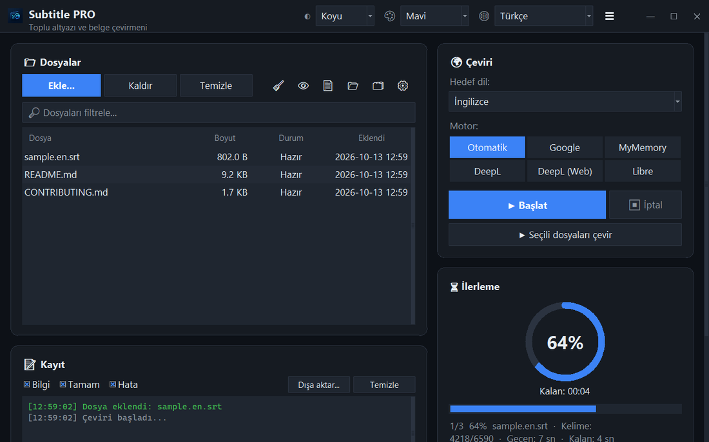

<div align="center">


# Subtitle PRO

**Altyazıları ve belgeleri toplu çevir — zaman damgaları, numaralar ve satır yapısı olduğu gibi korunur.**

[](https://github.com/noms6/subtitle-pro/actions/workflows/tests.yml)    [](../../LICENSE)

🌐 [English](../../README.md) · **Türkçe** · [Deutsch](README.de.md) · [Français](README.fr.md) · [Español](README.es.md) · [Italiano](README.it.md) · [Português](README.pt.md) · [Nederlands](README.nl.md) · [Polski](README.pl.md) · [Svenska](README.sv.md) · [Русский](README.ru.md) · [Українська](README.uk.md) · [العربية](README.ar.md) · [فارسی](README.fa.md) · [हिन्दी](README.hi.md) · [日本語](README.ja.md) · [한국어](README.ko.md) · [中文](README.zh.md) · [Bahasa Indonesia](README.id.md) · [Tiếng Việt](README.vi.md)



</div>

## ✨ Özellikler

- Hızlı: uzun metrajlı bir film (≈1.500 satır) yaklaşık 12 saniyede çevrilir — satırlar paketler hâlinde gönderilir
- Altyazılar: SRT ve VTT — sıra numaraları, zaman damgaları, `<i>` etiketler ve satır sonları korunur; Windows oynatıcılarının doğru okuduğu UTF-8 çıktı
- Belgeler: TXT, Markdown, CSV, DOCX (gövde, tablolar, üst/alt bilgi) ve PDF (PDF ya da TXT olarak kaydedilir)
- Motorlar: Google, MyMemory, DeepL API ve LibreTranslate — bir servis engellenirse otomatik olarak diğerine geçer
- Sürükle-bırak destekli dosya kuyruğu, isteğe bağlı paralel işleme, canlı ilerleme ve kalan süre
- Zaten hedef dilde olan dosyaları atlar; çeviriden önce ya da sonra uygulanan özel sözlük (JSON/CSV)
- 37 arayüz dili, 6 vurgu rengiyle açık ve koyu tema; tüm ayarlar hatırlanır
- Komut satırından da: `python translate_srt.py girdi.srt cikti.srt tr`

## 📥 Kurulum (Windows)

1. [Python 3.10 veya üstünü](https://www.python.org/downloads/) kurun ve “Add python.exe to PATH” kutusunu işaretleyin.
2. Projeyi indirin ([ZIP](https://github.com/noms6/subtitle-pro/archive/refs/heads/main.zip)) ya da klonlayın, ardından bağımlılıkları kurun:

   ```bash
   py -m pip install -r requirements.txt tkinterdnd2 langdetect
   ```

3. `run_app.bat` ya da `Subtitle PRO.pyw` dosyasına çift tıklayın — arkada konsol penceresi açık kalmaz.

## 🧭 Kullanım

1. **Ekle...** ile dosya seçin ya da dosyaları pencereye sürükleyin.
2. Hedef dili ve motoru seçin (**Otomatik** önerilir).
3. **▶ Başlat**'a basın. Sonuç orijinalin yanına kaydedilir, örn. `film.en.tr.srt`.
4. Sonucu kontrol edin — isimler ve “Ah!” gibi ünlemler bilerek değiştirilmez.

## 🖼️ Ekran görüntüleri

<table>
<tr><td align="center"><br>Ana pencere</td><td align="center"><br>Boş kuyruk — dosyaları buraya bırakın</td></tr>
<tr><td align="center"><br>Ayarlar</td><td align="center"><br>Sağdan sola diller</td></tr>
</table>

## 📊 Proje durumu

Aktif olarak geliştiriliyor, 270'ten fazla otomatik testle korunuyor. Bilinen sorunlar ve yol haritası: [KNOWN_ISSUES](../../docs/KNOWN_ISSUES.md) ve [ROADMAP](../../docs/ROADMAP.md).

## 🛠️ Geliştirme

Mimari, testler ve çeviri rehberi için [ana README](../../README.md#development) sayfasına bakın.

## 📜 Lisans

[MIT](../../LICENSE) © noms6
