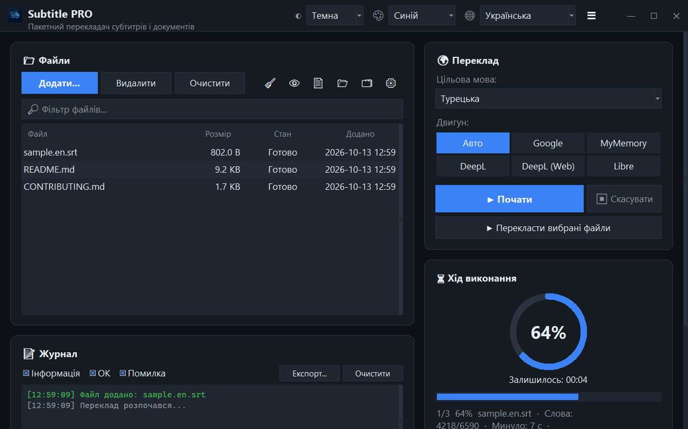

<div align="center">


# Subtitle PRO

**Пакетний переклад субтитрів і документів — таймкоди, нумерація та переноси рядків залишаються точно такими, як були.**

[](https://github.com/noms6/subtitle-pro/actions/workflows/tests.yml)    [](../../LICENSE)

🌐 [English](../../README.md) · [Türkçe](README.tr.md) · [Deutsch](README.de.md) · [Français](README.fr.md) · [Español](README.es.md) · [Italiano](README.it.md) · [Português](README.pt.md) · [Nederlands](README.nl.md) · [Polski](README.pl.md) · [Svenska](README.sv.md) · [Русский](README.ru.md) · **Українська** · [العربية](README.ar.md) · [فارسی](README.fa.md) · [हिन्दी](README.hi.md) · [日本語](README.ja.md) · [한국어](README.ko.md) · [中文](README.zh.md) · [Bahasa Indonesia](README.id.md) · [Tiếng Việt](README.vi.md)



</div>

## ✨ Можливості

- Швидко: повнометражний фільм (≈1500 рядків) перекладається приблизно за 12 секунд — рядки надсилаються пакетами
- Субтитри: SRT і VTT — номери, таймкоди, `<i>` теги й кінці рядків зберігаються; вивід у UTF-8, який правильно читають плеєри Windows
- Документи: TXT, Markdown, CSV, DOCX (текст, таблиці, колонтитули) і PDF (зберігається як PDF або TXT)
- Сервіси: Google, MyMemory, DeepL API і LibreTranslate — якщо сервіс обмежує запити, програма автоматично перемикається на інший
- Черга файлів із перетягуванням, необов’язкова паралельна обробка, поступ і залишок часу в реальному часі
- Пропускає файли, які вже написані цільовою мовою; власний глосарій (JSON/CSV) до або після перекладу
- Інтерфейс 37 мовами, світла й темна теми з 6 акцентними кольорами; усі налаштування запам’ятовуються
- Також із командного рядка: `python translate_srt.py input.srt output.srt uk`

## 📥 Встановлення (Windows)

1. Встановіть [Python 3.10 або новіший](https://www.python.org/downloads/) і позначте «Add python.exe to PATH».
2. Завантажте проєкт ([ZIP](https://github.com/noms6/subtitle-pro/archive/refs/heads/main.zip)) або клонуйте його, потім встановіть залежності:

   ```bash
   py -m pip install -r requirements.txt tkinterdnd2 langdetect
   ```

3. Двічі клацніть `run_app.bat` або `Subtitle PRO.pyw` — вікно консолі не залишається відкритим.

## 🧭 Як користуватися

1. Додайте файли кнопкою **Додати...** або перетягніть їх у вікно.
2. Виберіть цільову мову та сервіс (рекомендовано **Авто**).
3. Натисніть **▶ Почати**. Результат зберігається поруч з оригіналом, наприклад `film.en.uk.srt`.
4. Перевірте результат — імена та вигуки на кшталт «Ах!» навмисно не змінюються.

## 🖼️ Знімки екрана

<table>
<tr><td align="center"><br>Головне вікно</td><td align="center"><br>Порожня черга — перетягніть файли сюди</td></tr>
<tr><td align="center"><br>Налаштування</td><td align="center"><br>Мови з письмом справа наліво</td></tr>
</table>

## 📊 Стан проєкту

Активно розвивається й покритий понад 270 автотестами. Відомі проблеми та план розвитку (турецькою): [KNOWN_ISSUES](../../docs/KNOWN_ISSUES.md) і [ROADMAP](../../docs/ROADMAP.md).

## 🛠️ Розробка

Архітектура, тести та посібник із перекладу: див. [основний README](../../README.md#development).

## 📜 Ліцензія

[MIT](../../LICENSE) © noms6
