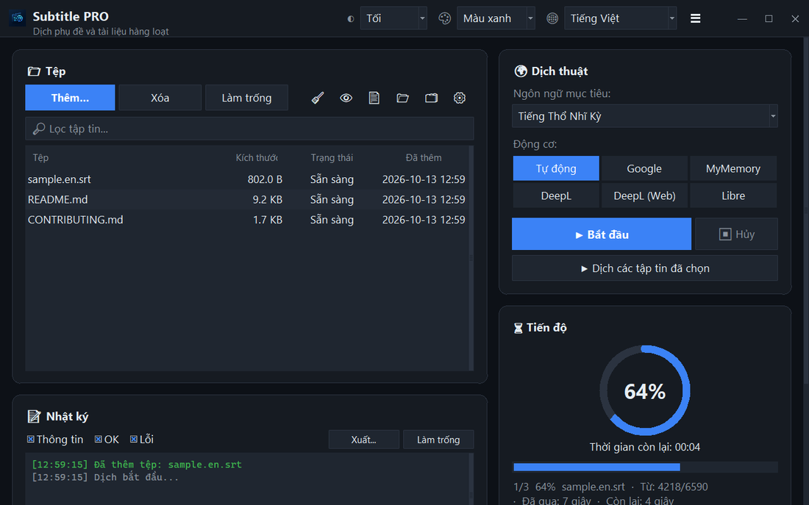

<div align="center">


# Subtitle PRO

**Dịch hàng loạt phụ đề và tài liệu — mốc thời gian, số thứ tự và ngắt dòng được giữ nguyên.**

[](https://github.com/noms6/subtitle-pro/actions/workflows/tests.yml)    [](../../LICENSE)

🌐 [English](../../README.md) · [Türkçe](README.tr.md) · [Deutsch](README.de.md) · [Français](README.fr.md) · [Español](README.es.md) · [Italiano](README.it.md) · [Português](README.pt.md) · [Nederlands](README.nl.md) · [Polski](README.pl.md) · [Svenska](README.sv.md) · [Русский](README.ru.md) · [Українська](README.uk.md) · [العربية](README.ar.md) · [فارسی](README.fa.md) · [हिन्दी](README.hi.md) · [日本語](README.ja.md) · [한국어](README.ko.md) · [中文](README.zh.md) · [Bahasa Indonesia](README.id.md) · **Tiếng Việt**



</div>

## ✨ Tính năng

- Nhanh: một bộ phim đầy đủ (≈1.500 dòng) được dịch trong khoảng 12 giây — các dòng được gửi theo lô
- Phụ đề: SRT và VTT — giữ nguyên số thứ tự, mốc thời gian, `<i>` thẻ và ký tự xuống dòng; xuất UTF-8 mà trình phát trên Windows đọc đúng
- Tài liệu: TXT, Markdown, CSV, DOCX (nội dung, bảng, đầu trang và chân trang) và PDF (lưu dưới dạng PDF hoặc TXT)
- Dịch vụ: Google, MyMemory, DeepL API và LibreTranslate — nếu một dịch vụ bị giới hạn, ứng dụng tự động chuyển sang dịch vụ khác
- Hàng đợi tệp hỗ trợ kéo thả, xử lý song song tùy chọn, hiển thị tiến độ và thời gian còn lại theo thời gian thực
- Bỏ qua tệp đã ở ngôn ngữ đích; bảng thuật ngữ riêng (JSON/CSV) áp dụng trước hoặc sau khi dịch
- Giao diện 37 ngôn ngữ, giao diện sáng và tối với 6 màu nhấn; mọi cài đặt đều được ghi nhớ
- Cũng dùng được từ dòng lệnh: `python translate_srt.py input.srt output.srt vi`

## 📥 Cài đặt (Windows)

1. Cài [Python 3.10 trở lên](https://www.python.org/downloads/) và đánh dấu “Add python.exe to PATH”.
2. Tải dự án ([ZIP](https://github.com/noms6/subtitle-pro/archive/refs/heads/main.zip)) hoặc sao chép kho mã, rồi cài các thư viện phụ thuộc:

   ```bash
   py -m pip install -r requirements.txt tkinterdnd2 langdetect
   ```

3. Nhấp đúp `run_app.bat` hoặc `Subtitle PRO.pyw` — không còn cửa sổ console nào mở.

## 🧭 Cách sử dụng

1. Thêm tệp bằng **Thêm...** hoặc kéo chúng vào cửa sổ.
2. Chọn ngôn ngữ đích và dịch vụ (khuyên dùng **Tự động**).
3. Nhấn **▶ Bắt đầu**. Kết quả được lưu cạnh tệp gốc, ví dụ `film.en.vi.srt`.
4. Kiểm tra kết quả — tên riêng và thán từ như “Ah!” được cố ý giữ nguyên.

## 🖼️ Ảnh chụp màn hình

<table>
<tr><td align="center"><br>Cửa sổ chính</td><td align="center"><br>Hàng đợi trống — thả tệp vào đây</td></tr>
<tr><td align="center"><br>Cài đặt</td><td align="center"><br>Ngôn ngữ viết từ phải sang trái</td></tr>
</table>

## 📊 Tình trạng dự án

Đang được phát triển tích cực và được bảo vệ bởi hơn 270 kiểm thử tự động. Vấn đề đã biết và lộ trình (tiếng Thổ Nhĩ Kỳ): [KNOWN_ISSUES](../../docs/KNOWN_ISSUES.md) và [ROADMAP](../../docs/ROADMAP.md).

## 🛠️ Phát triển

Kiến trúc, kiểm thử và hướng dẫn dịch: xem [README chính](../../README.md#development).

## 📜 Giấy phép

[MIT](../../LICENSE) © noms6
