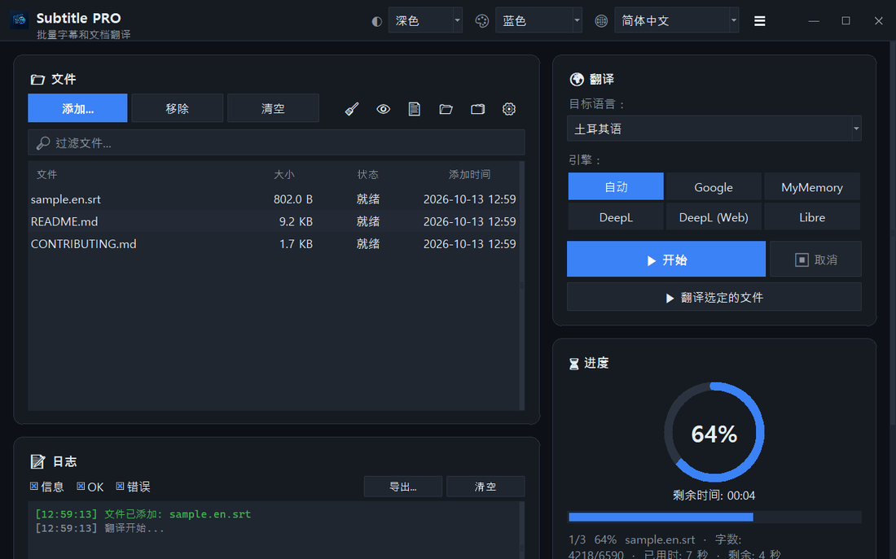

<div align="center">


# Subtitle PRO

**批量翻译字幕和文档 — 时间轴、编号和换行完全保持不变。**

[](https://github.com/noms6/subtitle-pro/actions/workflows/tests.yml)    [](../../LICENSE)

🌐 [English](../../README.md) · [Türkçe](README.tr.md) · [Deutsch](README.de.md) · [Français](README.fr.md) · [Español](README.es.md) · [Italiano](README.it.md) · [Português](README.pt.md) · [Nederlands](README.nl.md) · [Polski](README.pl.md) · [Svenska](README.sv.md) · [Русский](README.ru.md) · [Українська](README.uk.md) · [العربية](README.ar.md) · [فارسی](README.fa.md) · [हिन्दी](README.hi.md) · [日本語](README.ja.md) · [한국어](README.ko.md) · **中文** · [Bahasa Indonesia](README.id.md) · [Tiếng Việt](README.vi.md)



</div>

## ✨ 功能

- 快速：一整部电影（约 1,500 行）大约 12 秒即可翻译完成 — 按批发送多行
- 字幕：SRT 和 VTT — 保留编号、时间轴、`<i>` 标签和换行符；输出 Windows 播放器能正确读取的 UTF-8
- 文档：TXT、Markdown、CSV、DOCX（正文、表格、页眉页脚）和 PDF（保存为 PDF 或 TXT）
- 翻译服务：Google、MyMemory、DeepL API 和 LibreTranslate — 某个服务被限流时会自动切换到其他服务
- 支持拖放的文件队列，可选并行处理，实时显示进度和剩余时间
- 自动跳过已是目标语言的文件；可在翻译前或翻译后应用自定义术语表（JSON/CSV）
- 37 种界面语言，浅色和深色主题，6 种强调色；所有设置都会被记住
- 也可以使用命令行：`python translate_srt.py input.srt output.srt zh-CN`

## 📥 安装（Windows）

1. 安装 [Python 3.10 或更高版本](https://www.python.org/downloads/)，并勾选“Add python.exe to PATH”。
2. 下载项目（[ZIP](https://github.com/noms6/subtitle-pro/archive/refs/heads/main.zip)）或克隆仓库，然后安装依赖：

   ```bash
   py -m pip install -r requirements.txt tkinterdnd2 langdetect
   ```

3. 双击 `run_app.bat` 或 `Subtitle PRO.pyw` — 不会留下控制台窗口。

## 🧭 使用方法

1. 点击 **添加...** 选择文件，或直接把文件拖进窗口。
2. 选择目标语言和翻译服务（推荐 **自动**）。
3. 点击 **▶ 开始**。结果保存在原文件旁边，例如 `film.en.zh-CN.srt`。
4. 检查结果 — 人名和“Ah!”之类的感叹词会刻意保持原样。

## 🖼️ 截图

<table>
<tr><td align="center"><br>主窗口</td><td align="center"><br>空队列 — 把文件拖到这里</td></tr>
<tr><td align="center"><br>设置</td><td align="center"><br>从右到左书写的语言</td></tr>
</table>

## 📊 项目状态

正在积极开发，并由 270 多个自动化测试保障。已知问题和路线图（土耳其语）：[KNOWN_ISSUES](../../docs/KNOWN_ISSUES.md) 和 [ROADMAP](../../docs/ROADMAP.md)。

## 🛠️ 开发

架构、测试和翻译指南：请参阅[主 README](../../README.md#development)。

## 📜 许可证

[MIT](../../LICENSE) © noms6
